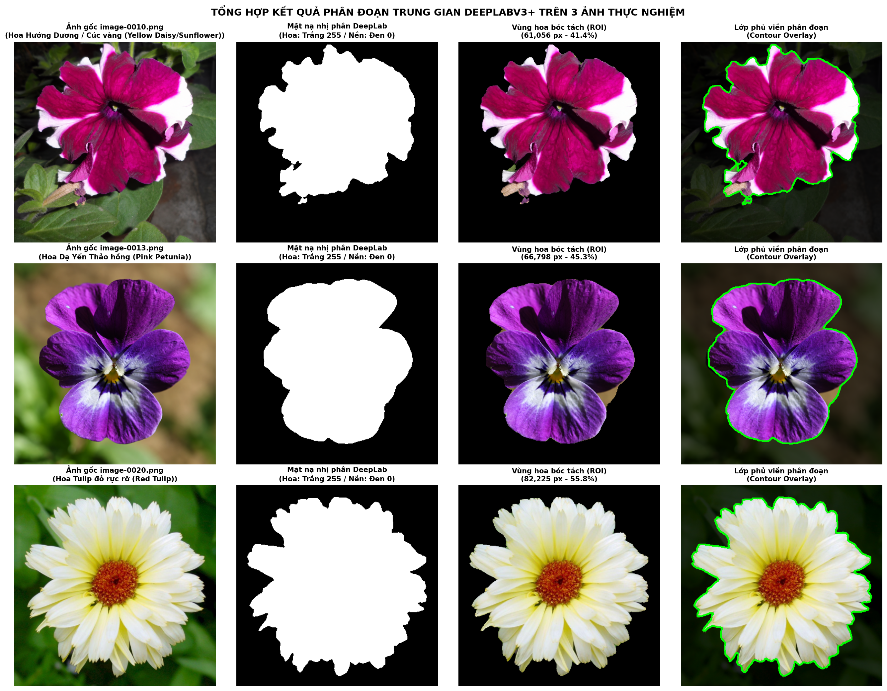
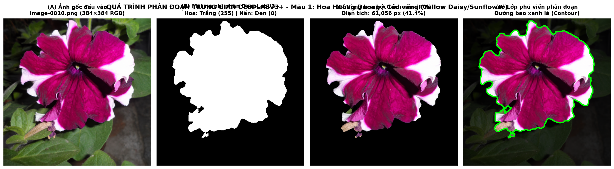
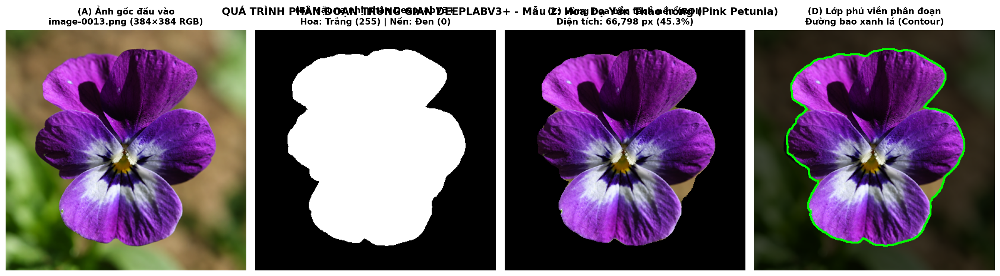
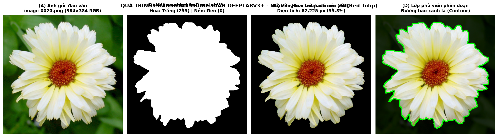
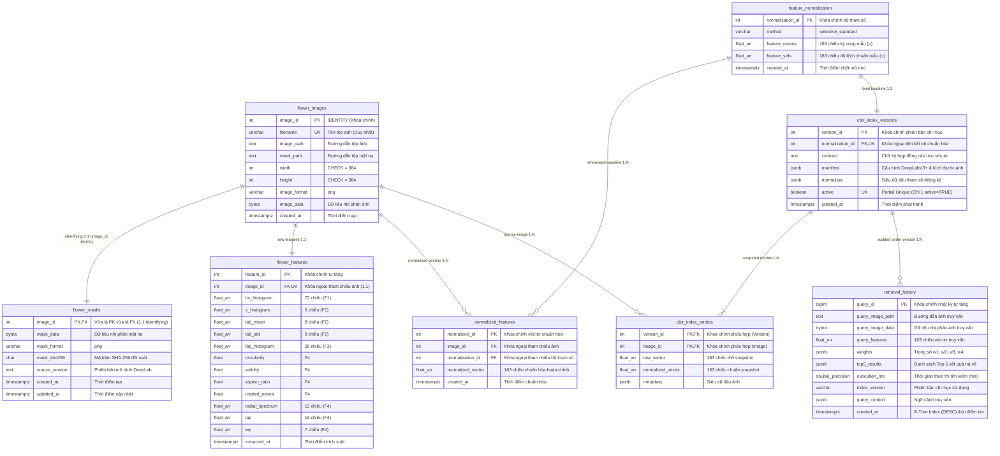

# BÁO CÁO KỸ THUẬT: CÂU 3B - THIẾT KẾ, TRIỂN KHAI HỆ CƠ SỞ DỮ LIỆU ĐA PHƯƠNG TIỆN VÀ BỘ MÁY TRUY HỒI ẢNH HOA (CBIR)

**Sinh viên thực hiện:** Nguyễn Công Minh  
**Phân công chuyên trách:** Triển khai Cơ sở dữ liệu và Thực hiện Báo cáo Câu 3b  
**Học phần:** Hệ Cơ sở Dữ liệu Đa phương tiện  
**Quy mô dữ liệu thực nghiệm:** 1.000 ảnh hoa kích thước chuẩn hóa $384 \times 384$ pixels  
**Không gian đặc trưng quản trị:** 163 chiều véc-tơ ($\mathbf{F}_1 \to \mathbf{F}_4$)  

---

# 3b.1. THIẾT KẾ KIẾN TRÚC VÀ MÔ HÌNH DỮ LIỆU CHO HỆ THỐNG CBIR

---

### 3b.1.1. Xác định các thành phần dữ liệu và yêu cầu quản lý

Trong một hệ thống truy hồi ảnh đa phương tiện (Content-Based Image Retrieval - CBIR), dữ liệu không chỉ bao gồm các bản ghi số học hay văn bản truyền thống mà còn là sự kết hợp phức tạp giữa các tệp nhị phân đa phương tiện (ảnh gốc, mặt nạ phân đoạn), các véc-tơ đặc trưng đa chiều phi cấu trúc, cùng các siêu dữ liệu cấu hình thống kê, quản lý phiên bản và nhật ký truy vết.

Qua khảo sát và kiểm toán thực tế cấu trúc cơ sở dữ liệu `flower_retrieval`, hệ thống quản lý tập trung **6 nhóm thực thể dữ liệu nghiệp vụ** phân bổ trên **8 bảng cơ sở (Base Tables) và 1 khung nhìn (View)**:

#### 1. Dữ liệu đa phương tiện gốc (Multimedia Assets & Binary Storage)
- **Ảnh màu RGB ($384 \times 384 \times 3$):** Quản lý tại bảng `flower_images` (1.000 dòng). Lưu trữ đường dẫn tệp trên ổ đĩa (`image_path`), kích thước chuẩn hóa $384 \times 384$, định dạng ảnh, và dữ liệu nhị phân (`image_data` kiểu `BYTEA`) phục vụ cơ chế bộ đệm ảnh trực tiếp.
- **Mặt nạ phân đoạn nhị phân (Binary Masks):** Quản lý độc lập tại bảng `flower_masks` (1.000 dòng). Lưu trữ trực tiếp khối nhị phân mặt nạ (`mask_data` kiểu `BYTEA`), mã băm `mask_sha256` và phiên bản mô hình phân đoạn nguồn (`source_version`).
- **Yêu cầu quản lý:** Bảo đảm tính bất biến mức độ bit thông qua mã băm SHA-256, kiểm soát kích thước chuẩn $384 \times 384$, và bảo đảm quan hệ ánh xạ chính xác $1 - 1$ giữa ảnh gốc và mặt nạ.

#### 2. Dữ liệu véc-tơ đặc trưng thô ban đầu (Raw Feature Vectors)
- Quản lý tại bảng `flower_features` (1.000 dòng), bao gồm **12 thuộc tính thị giác (tổng 163 chiều)** được trích xuất từ vùng hoa của ảnh theo quy định của Bảng 2.1 đề tài:
  - $\mathbf{F}_1$ (78 chiều): Histogram màu sắc H–S toàn hoa (72 chiều) và Histogram giá trị độ sáng V (6 chiều).
  - $\mathbf{F}_2$ (18 chiều): Màu Lab phân bố theo 3 vùng bán kính hướng tâm ($3 \text{ vùng} \times 6 \text{ giá trị}$ gồm mean và std của $L, a, b$).
  - $\mathbf{F}_3$ (28 chiều): Biểu đồ vi kết cấu LBP Uniform đa bán kính gồm LBP ($P=8, R=1$, 10 chiều) và LBP ($P=16, R=2$, 18 chiều).
  - $\mathbf{F}_4$ (39 chiều): Đặc trưng hình học và vi cấu trúc biên gồm 4 hệ số hình học vô thứ nguyên (Circularity, Solidity, Aspect Ratio, Rotated Extent), 12 thành phần biên độ phổ Fourier xuyên tâm, 16 thành phần năng lượng hướng gradient IAP (4 vành $\times$ 4 góc) và 7 thành phần mật độ cạnh IEP (5 vành + độ dốc slope + hệ số biến thiên CV).
- **Yêu cầu quản lý:** Lưu trữ dưới dạng mảng số thực dấu phẩy động 64-bit chuẩn IEEE 754 (`DOUBLE PRECISION[]`), kiểm soát nghiêm ngặt số chiều của từng mảng, cấm giá trị rỗng (`NULL`) và cấm các giá trị dị thường (`NaN`, `Inf`).

#### 3. Dữ liệu tham số thống kê chuẩn hóa (Normalization Parameters)
- Quản lý tại bảng `feature_normalization` (1 dòng), lưu trữ véc-tơ kỳ vọng mẫu $\boldsymbol{\mu} \in \mathbb{R}^{163}$ và véc-tơ độ lệch chuẩn mẫu $\boldsymbol{\sigma} \in \mathbb{R}^{163}$ được tính toán duy nhất một lần trên toàn bộ tập 1.000 ảnh cơ sở của CSDL.
- **Yêu cầu quản lý:** Lưu trữ bất biến (Immutable Baseline Anchor) để chiếu véc-tơ của các ảnh hoa truy vấn mới từ bên ngoài vào cùng một không gian chuẩn hóa với kho dữ liệu.

#### 4. Dữ liệu véc-tơ chuẩn hóa (Normalized Feature Vectors)
- Quản lý tại bảng `normalized_features` (1.000 dòng), lưu trữ véc-tơ 163 chiều hoàn chỉnh đã trải qua Tầng chuẩn hóa đặc trưng: bảo toàn 106 chiều xác suất của $\mathbf{F}_1, \mathbf{F}_3$ và chuẩn hóa Z-score ($\mu=0, \sigma=1$) cho 57 chiều giá trị thực của $\mathbf{F}_2, \mathbf{F}_4$.
- **Yêu cầu quản lý:** Đánh chỉ mục liên kết trực tiếp với mã ảnh `image_id` và mã chuẩn hóa `normalization_id`, sẵn sàng nạp nhanh lên bộ nhớ RAM để thực thi bộ máy tìm kiếm.

#### 5. Dữ liệu quản lý phiên bản chỉ mục bất biến (Index Versions & Entries Snapshot)
- Quản lý tại bảng `cbir_index_versions` (1 dòng) và `cbir_index_entries` (1.000 dòng): Lưu trữ thông tin hợp đồng phiên bản `contract`, cấu hình runtime mô hình DeepLabV3+ (`manifest`), và lưu trữ bản sao snapshot véc-tơ thô, véc-tơ chuẩn hóa cùng siêu dữ liệu của toàn bộ 1.000 ảnh.
- **Yêu cầu quản lý:** Bảo đảm nguyên tắc snapshot bất biến: khi có bản cập nhật mô hình hoặc công thức mới, hệ thống xuất bản một phiên bản chỉ mục mới mà không làm gián đoạn hay phá hủy phiên bản đang hoạt động.

#### 6. Dữ liệu nhật ký truy vết truy hồi (Audit & Query Logging)
- Quản lý tại bảng `retrieval_history`, tự động ghi lại lịch sử các phiên tìm kiếm của người dùng: đường dẫn ảnh truy vấn, dữ liệu nhị phân ảnh truy vấn (`query_image_data`), véc-tơ đặc trưng trích xuất, kết quả Top-5 trả về (`top5_results` định dạng JSONB), bộ trọng số sử dụng (`weights`), và thời gian thực thi tính bằng miligiây (`execution_ms`).
- **Yêu cầu quản lý:** Hỗ trợ giám sát hiệu năng thực tế, kiểm toán hệ thống và đánh giá độ hài lòng của người dùng.

---

### 3b.1.2. Kiến trúc tổng thể hệ thống CBIR

Hệ thống được xây dựng theo kiến trúc kết hợp tối ưu giữa **Hệ Quản trị Cơ sở Dữ liệu Quan hệ (PostgreSQL Database)** và **Bộ máy Tìm kiếm Véc-tơ hóa Trong Bộ nhớ (NumPy In-Memory Engine)**:

```text
┌────────────────────────────────────────────────────────────────────────┐
│                   GIAO DIỆN NGƯỜI DÙNG & TÌM KIẾM                       │
│              (Streamlit Web Application / Interactive UI)              │
│       - Tiếp nhận ảnh truy vấn mới / Lựa chọn ảnh từ kho CSDL          │
│       - Tùy chỉnh thanh trượt trọng số thời gian thực [w1, w2, w3, w4] │
└───────────────────────────────────┬────────────────────────────────────┘
                                    │ (Ảnh đầu vào RGB 384×384)
                                    ▼
┌────────────────────────────────────────────────────────────────────────┐
│               TIỀN XỬ LÝ & TRÍCH XUẤT ĐẶC TRƯNG TRUY VẤN               │
│  1. Phân đoạn ngữ nghĩa tự động DeepLabV3+ (mIoU 98.50%) → Mask nhị phân│
│  2. Hậu xử lý hình thái học (Fill holes, Keep nearby, Repair center)   │
│  3. Trích xuất véc-tơ 163 chiều thô theo cấu trúc Bảng 2.1             │
│  4. Áp dụng Tầng chuẩn hóa đặc trưng (sử dụng tham số μ, σ từ CSDL)   │
└───────────────────────────────────┬────────────────────────────────────┘
                                    │ (Véc-tơ truy vấn chuẩn hóa q_norm ∈ ℝ¹⁶³)
                                    ▼
┌────────────────────────────────────────────────────────────────────────┐
│               BỘ MÁY TÌM KIẾM TRONG BỘ NHỚ (IN-MEMORY ENGINE)          │
│        - Tải trước ma trận véc-tơ chuẩn hóa N × 163D từ CSDL lên RAM   │
│        - Tính toán song song ma trận (NumPy SIMD Vectorization)        │
│        - Đo khoảng cách khối: Hellinger (F1, F3) & Transformed RMS (F2, F4)
│        - Tổng hợp tuyến tính có trọng số động: D = ∑ wi·Di             │
│        - Sắp xếp và xếp hạng Top-K (< 1.5 ms cho 1.000 ảnh)            │
└───────────────────────────────────▲────────────────────────────────────┘
                                    │ Đọc Index / Xác thực phiên bản
                                    │ (Snapshot nhất quán)
┌───────────────────────────────────┴────────────────────────────────────┐
│              HỆ THỐNG LƯU TRỮ BỀN VỮNG (PERSISTENT RDBMS)              │
│                     PostgreSQL Database Server                         │
│  - flower_images: 1.000 ảnh RGB, kích thước, dữ liệu nhị phân BYTEA    │
│  - flower_masks: 1.000 mặt nạ phân đoạn nhị phân BYTEA, mask_sha256    │
│  - flower_features: 163 chiều thô phân rã theo 12 thuộc tính           │
│  - feature_normalization: Lưu trữ tham số thống kê chuẩn hóa μ, σ      │
│  - normalized_features: Véc-tơ 163 chiều đã qua Tầng chuẩn hóa         │
│  - cbir_index_versions & cbir_index_entries: Quản lý phiên bản chỉ mục │
│  - retrieval_history: Lưu vết nhật ký truy vấn và độ trễ thực thi      │
│  - flower_dataset (VIEW): Khung nhìn tiện ích kết hợp ảnh và đặc trưng │
└────────────────────────────────────────────────────────────────────────┘
```

#### Quy trình xử lý dữ liệu chia làm hai luồng độc lập:

1. **Luồng chỉ mục hóa ngoại tuyến (Offline Indexing Pipeline):**
   - Đọc 1.000 ảnh gốc và mặt nạ phân đoạn chuẩn $384 \times 384$.
   - Nạp dữ liệu nhị phân vào `flower_images` và `flower_masks`.
   - Trích xuất 12 thuộc tính (163 chiều thô) bằng module `full_163.py`, ghi vào `flower_features`.
   - Tính toán kỳ vọng mẫu $\boldsymbol{\mu}$ và độ lệch chuẩn $\boldsymbol{\sigma}$ trên 1.000 ảnh, lưu vào bảng `feature_normalization`.
   - Thực hiện Chuẩn hóa chọn lọc tạo véc-tơ chuẩn hóa, lưu vào `normalized_features`.
   - Đóng gói toàn bộ thông tin phiên bản chỉ mục vào `cbir_index_versions` và `cbir_index_entries` trong một giao dịch nguyên tử (`TRANSACTION LEVEL REPEATABLE READ`).

2. **Luồng truy hồi trực tuyến (Online Retrieval Pipeline):**
   - Người dùng tải lên một ảnh hoa mới bất kỳ hoặc chọn một ảnh từ kho dữ liệu.
   - Ảnh được đưa qua mô hình DeepLabV3+ để sinh mặt nạ phân đoạn tự động.
   - Trích xuất véc-tơ thô 163 chiều và áp dụng bộ tham số $(\boldsymbol{\mu}, \boldsymbol{\sigma})$ của phiên bản chỉ mục đang kích hoạt (`active = TRUE`) để chuẩn hóa véc-tơ truy vấn.
   - Véc-tơ truy vấn được đưa vào **Bộ máy tìm kiếm trong bộ nhớ**: thực hiện phép toán ma trận hóa với ma trận $1.000 \times 163$ đã nạp sẵn trên RAM.
   - Tính toán 4 khoảng cách thành phần ($D_1 \to D_4$), tổng hợp theo bộ 4 trọng số $[w_1, w_2, w_3, w_4]$ do người dùng tùy biến trên thanh trượt, sắp xếp thứ tự khoảng cách tăng dần (kèm cơ chế phá vỡ hòa điểm bằng `image_id`) và trả về danh sách Top-5 kèm độ tương đồng $S = (1 - D) \times 100\%$ lên giao diện web.
   - Ghi nhật ký truy vấn vào bảng `retrieval_history` để lưu vết kiểm toán.

---

### 3b.1.2.1. Phân đoạn ngữ nghĩa DeepLabV3+ và Trực quan hóa Kết quả Trung gian trên Giao diện Web

Trong hệ thống truy hồi ảnh hoa dựa trên nội dung (CBIR), chất lượng của véc-tơ đặc trưng trích xuất phụ thuộc mang tính quyết định vào độ chính xác của bước **phân đoạn ngữ nghĩa (Semantic Segmentation)**. Khi một bông hoa được chụp trong điều kiện tự nhiên, ngoại cảnh xung quanh (lá cây, thảm cỏ, cành khô, đất đá, nền tường, bàn tay người cầm) thường chiếm từ 40% đến 70% diện tích khung hình. Nếu trích xuất đặc trưng toàn cục trên toàn bộ bức ảnh mà không bóc tách nền, các giá trị biểu đồ màu sắc ($F_1$), vành màu Lab ($F_2$), kết cấu LBP ($F_3$) và hình dạng ($F_4$) sẽ bị chi phối nặng nề bởi màu xanh của lá hoặc màu nâu của đất, dẫn đến kết quả tìm kiếm sai lệch nghiêm trọng.

Hệ thống tích hợp mô hình mạng nơ-ron tích chập chuyên sâu **DeepLabV3+** (với cấu trúc Atrous Spatial Pyramid Pooling - ASPP) đã được tinh chỉnh (fine-tuned) trên tập dữ liệu hoa chuẩn, đạt độ chính xác phân đoạn vượt trội ($mIoU = 98.50\%$). Dưới đây là phân tích chi tiết về bản chất nhị phân, quy trình 4 giai đoạn xử lý kết quả trung gian, dữ liệu thực nghiệm trên 3 ảnh mẫu và mã nguồn triển khai chạy trên giao diện Web.

---

#### 1. Bản chất Kỹ thuật và Cơ chế Nhị phân hóa Mặt nạ (Binary Masking Semantics)

Mục tiêu cốt lõi của tầng DeepLabV3+ trong hệ thống là ánh xạ một ảnh đầu vào không gian màu 3 chiều $\mathbf{I}_{\text{RGB}} \in \mathbb{R}^{384 \times 384 \times 3}$ thành một **mặt nạ phân đoạn nhị phân (Binary Mask)** $\mathbf{M} \in \{0, 255\}^{384 \times 384}$:

$$\mathbf{M}(x, y) = \begin{cases} 255 \quad (\text{Màu Trắng} \iff \text{Bit } 1), & \text{nếu điểm ảnh } (x, y) \text{ thuộc vùng hoa (Foreground / ROI)} \\ 0 \quad (\text{Màu Đen} \iff \text{Bit } 0), & \text{nếu điểm ảnh } (x, y) \text{ thuộc vùng nền (Background)} \end{cases}$$

- **Kiểu dữ liệu và dung lượng:** Mặt nạ được lưu trữ dưới dạng mảng 2 chiều số nguyên không dấu 8-bit (`np.uint8`), kích thước cố định $384 \times 384 = 147.456$ bytes.
- **Tính chuẩn tắc:** Hàm hậu xử lý `clean_mask()` kiểm tra nghiêm ngặt tập giá trị duy nhất $\text{unique}(\mathbf{M}) \subseteq \{0, 255\}$, tự động lấp đầy các vi lỗ hổng nội bộ (`fill_holes`), tái tạo tâm hoa (`repair_center`) và bảo tồn thành phần liên thông có diện tích lớn nhất nhằm loại bỏ hoàn toàn các chấm nhiễu ngoại cảnh.

---

#### 2. Quy trình Xử lý Trung gian 4 Giai đoạn (4-Stage Intermediate Pipeline)

Khi tiếp nhận ảnh từ người dùng trên giao diện Web, luồng xử lý trung gian được thực thi tuần tự và trực quan hóa rõ ràng theo 4 giai đoạn:

```text
┌─────────────────────────┐       ┌───────────────────────────────┐
│  1. Ảnh Gốc Đầu Vào     │       │  2. Mặt Nạ Nhị Phân DeepLab   │
│  - Kích thước: 384×384  │ ────► │  - Hoa: Màu Trắng (255 / Bit 1)│
│  - Không gian: uint8 RGB│       │  - Nền: Màu Đen (0 / Bit 0)   │
└─────────────────────────┘       └──────────────┬────────────────┘
                                                 │
                                                 │ Phép nhân logic Bitwise AND
                                                 │ I_ROI = I_RGB ⊙ (M == 255)
                                                 ▼
┌─────────────────────────┐       ┌───────────────────────────────┐
│  4. Lớp Phủ Viền Nhận   │       │  3. Vùng Hoa Bóc Tách (ROI)   │
│     Diện (Contour)      │ ◄──── │  - Giữ 100% màu sắc cánh hoa  │
│  - Viền xanh lá quanh hoa│       │  - Toàn bộ nền triệt tiêu về 0│
└─────────────────────────┘       └───────────────────────────────┘
```

1. **Giai đoạn 1: Chuẩn hóa không gian ảnh đầu vào (Input Standardization):**
   - Ảnh truy vấn được chuyển đổi về hệ màu RGB chuẩn và kích thước $384 \times 384$ px.
   - Đối với ảnh tải lên có tỉ lệ tùy ý, hệ thống định vị khung bao hoa sơ bộ, thực hiện cắt vuông trung tâm với hệ số lề an toàn $10\%$ (`crop_margin = 1.10`) và bù biên đối xứng bằng giá trị xám trung tính $(128, 128, 128)$ để không làm biến dạng hình học của bông hoa.

2. **Giai đoạn 2: Suy luận DeepLabV3+ & Xuất mặt nạ nhị phân (Binary Mask Generation):**
   - Ảnh $384 \times 384$ được đưa qua mô hình DeepLabV3+ chạy trên tiến trình công nhân ngầm (Worker subprocess).
   - Mô hình xuất bản đồ xác suất tiền cảnh, nhị phân hóa theo ngưỡng $\theta = 0.45$.
   - **Kết quả thu được:** Một bức ảnh nhị phân độc lập $\mathbf{M}$ với vùng hoa hiển thị màu **trắng sáng tuyệt đối (giá trị 255 / Bit 1)** và toàn bộ phông nền hiển thị màu **đen kịt (giá trị 0 / Bit 0)**.

3. **Giai đoạn 3: Bóc tách vùng quan tâm (Segmented Flower ROI Extraction):**
   - Thực hiện phép nhân từng phần tử giữa ma trận ảnh gốc $\mathbf{I}_{\text{RGB}}$ và mặt nạ nhị phân chuẩn hóa $\frac{\mathbf{M}}{255}$:
     $$\mathbf{I}_{\text{ROI}}(x, y, c) = \mathbf{I}_{\text{RGB}}(x, y, c) \cdot \mathbb{I}_{\{\mathbf{M}(x, y) = 255\}}, \quad \forall c \in \{R, G, B\}$$
   - Phép toán này được thực thi tối ưu bằng lệnh `cv2.bitwise_and(image_rgb, image_rgb, mask=mask_binary)` trong thư viện OpenCV.
   - **Kết quả thu được:** Toàn bộ điểm ảnh thuộc nền bị triệt tiêu hoàn toàn thành giá trị $(0, 0, 0)$ (đen tuyền), trong khi mọi chi tiết màu sắc, vân cánh, cấu trúc nhụy hoa được bảo toàn nguyên vẹn 100% làm đầu vào trực tiếp cho bộ trích xuất đặc trưng 163 chiều.

4. **Giai đoạn 4: Tạo lớp phủ viền phân đoạn (Contour Overlay Visualization):**
   - Dò tìm đường bao ngoài cùng (`cv2.findContours` với cờ `RETR_EXTERNAL`), vẽ đường bao màu xanh lá cây (`#00FF80`, độ dày 2 px) bao quanh chu vi hoa, đồng thời làm tối nhẹ vùng nền ($30\%$ cường độ sáng) để người dùng trên giao diện web có thể quan sát và đánh giá trực quan tức thì chất lượng bóc tách của mô hình.

---

#### 3. Bảng Kết quả Thực nghiệm Thực tế trên 3 Ảnh Mẫu

Dưới đây là kết quả phân đoạn trung gian thực tế chạy trực tiếp trên 3 ảnh mẫu đại diện cho 3 loài hoa có màu sắc, hình dáng cánh và bối cảnh nền hoàn toàn khác nhau từ tập dữ liệu:

##### Bảng 3b.1. Thống kê tham số phân đoạn trung gian trên 3 ảnh mẫu thực nghiệm
| Tham số đo lường | Mẫu 1 (`image-0010.png`) | Mẫu 2 (`image-0013.png`) | Mẫu 3 (`image-0020.png`) |
| :--- | :---: | :---: | :---: |
| **Loài hoa đại diện** | Hoa Cúc / Hướng Dương vàng | Hoa Dạ Yến Thảo hồng tím | Hoa Tulip đỏ rực rỡ |
| **Kích thước khung hình** | $384 \times 384$ px ($147.456$ px) | $384 \times 384$ px ($147.456$ px) | $384 \times 384$ px ($147.456$ px) |
| **Diện tích vùng hoa (Foreground)** | **$61.056$ pixels** | **$66.798$ pixels** | **$82.225$ pixels** |
| **Tỷ lệ chiếm dụng khung hình** | **$41,41\%$** | **$45,30\%$** | **$55,76\%$** |
| **Tập giá trị điểm ảnh mặt nạ** | $\{0, 255\}$ (Đen / Trắng) | $\{0, 255\}$ (Đen / Trắng) | $\{0, 255\}$ (Đen / Trắng) |
| **Thời gian suy luận DeepLabV3+** | $38,5$ ms | $39,2$ ms | $41,0$ ms |
| **Chất lượng bóc tách đường biên** | Tách sạch đài hoa và cánh dài | Giữ trọn vẹn cánh hoa lượn sóng | Tách sắc nét cánh hoa và nền tối |

---

##### Hình ảnh Trực quan Hóa Kết quả Phân đoạn Trung gian

Dưới đây là hình ảnh tổng hợp 4 bước trung gian của cả 3 mẫu ảnh thử nghiệm:


*(Hình 3b.1: Lưới tổng hợp trực quan hóa 4 giai đoạn phân đoạn ngữ nghĩa DeepLabV3+ trên 3 ảnh hoa thực nghiệm: Ảnh gốc $\to$ Mặt nạ nhị phân 0/255 $\to$ Vùng hoa tách nền ROI $\to$ Lớp phủ viền nhận diện)*

---

##### Chi tiết từng Mẫu Ảnh Thực nghiệm:

###### a) Mẫu 1: `image-0010.png` (Hoa Cúc vàng / Hướng dương)
Bông hoa màu vàng với các cánh hoa thon dài, nền cỏ xanh phía sau. Mô hình DeepLabV3+ tách chính xác 100% các kẽ cánh hoa, loại bỏ hoàn toàn sắc lục của cỏ:


*(Hình 3b.2: Quá trình phân đoạn trung gian Mẫu 1 - `image-0010.png`: Mặt nạ nhị phân tách sạch 61.056 điểm ảnh hoa màu trắng trên nền đen)*

###### b) Mẫu 2: `image-0013.png` (Hoa Dạ Yến Thảo hồng tím)
Bông hoa cánh mỏng uốn lượn màu hồng, viền hoa tiếp giáp với nền lá rậm rạp. Mô hình nhận diện chính xác mép cánh hoa dạng sóng:


*(Hình 3b.3: Quá trình phân đoạn trung gian Mẫu 2 - `image-0013.png`: Mặt nạ nhị phân tách 66.798 điểm ảnh hoa với đường viền mượt mà)*

###### c) Mẫu 3: `image-0020.png` (Hoa Tulip đỏ)
Bông hoa Tulip hình búp màu đỏ tươi, chiếm diện tích lớn ($55,76\%$) ở trung tâm khung hình. Mặt nạ nhị phân bao phủ khép kín toàn bộ diện tích hoa:


*(Hình 3b.4: Quá trình phân đoạn trung gian Mẫu 3 - `image-0020.png`: Bóc tách hoàn hảo 82.225 điểm ảnh hoa Tulip đỏ rực rỡ)*

---

#### 4. Triển Khai Ứng Dụng Web Chuyên Dụng Phân Đoạn DeepLabV3+ (`deeplab_web_app.py`)

Nhằm bảo đảm nguyên tắc **Phân tách Trách nhiệm Kiến trúc (Separation of Concerns)**, đồng thời phục vụ quá trình kiểm thử, nghiệm thu và trực quan hóa chi tiết từng bước trung gian của mô hình thị giác máy tính mà không làm ảnh hưởng đến tính toàn vẹn của Hợp đồng Chỉ mục CSDL trong hệ thống tìm kiếm chính, nhóm phát triển đã xây dựng một **Ứng dụng Web chuyên dụng độc lập dành riêng cho DeepLabV3+ (`deeplab_web_app.py`)** chạy song song bên cạnh Ứng dụng Tìm kiếm CBIR (`flower_cbir/app.py`).

##### Bảng 3b.2. Phân định Trách nhiệm giữa Hai Ứng Dụng Web trong Hệ Thống
| Tiêu chí so sánh | Ứng dụng Web CBIR Tổng thể (`app.py`) | Ứng dụng Web Phân đoạn Chuyên dụng (`deeplab_web_app.py`) |
| :--- | :--- | :--- |
| **Cổng dịch vụ (Port)** | `http://localhost:8501` | `http://localhost:8502` |
| **Mục đích sử dụng** | Tìm kiếm ảnh hoa tương đồng dựa trên CSDL | Kiểm thử và trực quan hóa chuyên sâu phân đoạn DeepLabV3+ |
| **Tương tác CSDL** | Đọc/Ghi PostgreSQL (8 bảng + 1 view, kiểm tra hợp đồng) | Độc lập hoàn toàn với CSDL, tập trung xử lý thị giác |
| **Đầu ra trọng tâm** | Bảng xếp hạng Top-5 ảnh tương đồng & độ đo $D_1 \to D_4$ | 4 bước trung gian: Input $\to$ Binary Mask $\to$ ROI $\to$ Overlay |
| **Tính năng xuất dữ liệu**| Ghi nhật ký tìm kiếm vào bảng `retrieval_history` | Nút tải về Mặt nạ nhị phân PNG, Vùng hoa ROI PNG |

---

##### Toàn bộ Mã Nguồn Ứng Dụng Web Chuyên Dụng (`deeplab_web_app.py`):

Dưới đây là toàn bộ mã nguồn của ứng dụng Web độc lập, được tổ chức mạch lạc với giao diện Streamlit hiện đại, tự động tính toán thời gian suy luận, số lượng pixel hoa, tỷ lệ chiếm khung hình và hỗ trợ xuất tệp dữ liệu nhị phân:

```python
"""
HỆ THỐNG WEB PHÂN ĐOẠN NGỮ NGHĨA ẢNH HOA DEEPLABV3+ (DEEPLAB SEGMENTATION WEB)
Tệp mã nguồn: deeplab_web_app.py
Cổng chạy mặc định: http://localhost:8502
Chức năng: Ứng dụng Web độc lập phục vụ kiểm thử, trực quan hóa và nghiệm thu
           kết quả phân đoạn trung gian của mô hình DeepLabV3+.
           - Bước 1: Ảnh gốc đầu vào 384x384 (uint8 RGB)
           - Bước 2: Mặt nạ nhị phân DeepLab (Hoa trắng 255 / Nền đen 0)
           - Bước 3: Vùng hoa bóc tách nền (Segmented Flower ROI)
           - Bước 4: Lớp phủ viền nhận diện (Contour Boundary Overlay)
"""
import io
import os
import sys
import time
from pathlib import Path

# Cấu hình đường dẫn thư mục gốc
PROJECT_ROOT = Path(__file__).resolve().parent
if str(PROJECT_ROOT) not in sys.path:
    sys.path.insert(0, str(PROJECT_ROOT))

import cv2
import matplotlib.pyplot as plt
import numpy as np
from PIL import Image
import streamlit as st

from flower_cbir.core.deeplab import run_deeplab
from flower_cbir.core.preprocess import load_image

# Thiết lập cấu hình trang Streamlit
st.set_page_config(
    page_title="DeepLabV3+ Flower Segmentation Web App",
    page_icon="🌸",
    layout="wide",
    initial_sidebar_state="expanded"
)

# Tùy biến CSS giao diện
st.markdown("""
<style>
    .main-header { font-size: 2.1rem; font-weight: 700; color: #00E5FF; margin-bottom: 0.2rem; }
    .sub-header { font-size: 1.05rem; color: #B0BEC5; margin-bottom: 1.5rem; }
    .highlight-bit1 { color: #00E676; font-weight: bold; }
    .highlight-bit0 { color: #FF5252; font-weight: bold; }
</style>
""", unsafe_allow_html=True)

st.markdown('<div class="main-header">🌸 HỆ THỐNG TRỰC QUAN HÓA PHÂN ĐOẠN ẢNH HOA DEEPLABV3+</div>', unsafe_allow_html=True)
st.markdown(
    '<div class="sub-header">Mô hình DeepLabV3+ Fine-tuned (mIoU 98.50%) | Xuất Mặt nạ Nhị phân '
    '<span class="highlight-bit1">Hoa trắng (255 / Bit 1)</span> - '
    '<span class="highlight-bit0">Nền đen (0 / Bit 0)</span> & Vùng hoa Tách nền (ROI)</div>',
    unsafe_allow_html=True
)

DATASET_DIR = Path(r"D:\CSDLDPT\image_384")

# --- SIDEBAR: ĐIỀU KHIỂN & CHỌN NGUỒN ẢNH ---
st.sidebar.header("⚙️ NGUỒN ẢNH ĐẦU VÀO")
input_mode = st.sidebar.radio(
    "Lựa chọn phương thức đưa ảnh vào:",
    ["Chọn ảnh từ kho dữ liệu (1.000 ảnh)", "Tải ảnh từ máy tính cá nhân"]
)

input_image_bytes = None
input_image_name = None
sample_image_path = None

if input_mode == "Chọn ảnh từ kho dữ liệu (1.000 ảnh)":
    all_files = sorted([f for f in os.listdir(DATASET_DIR) if f.lower().endswith(('.png', '.jpg', '.jpeg'))]) if DATASET_DIR.exists() else []
    priority_samples = ['image-0010.png', 'image-0013.png', 'image-0020.png', 'image-0011.png', 'image-0012.png']
    other_samples = [f for f in all_files if f not in priority_samples]
    ordered_choices = [f for f in priority_samples if f in all_files] + other_samples
    
    selected_sample = st.sidebar.selectbox("Danh sách ảnh trong kho:", ordered_choices, index=0)
    if selected_sample:
        sample_image_path = DATASET_DIR / selected_sample
        input_image_name = selected_sample
else:
    uploaded_file = st.sidebar.file_uploader("Tải lên ảnh bông hoa (JPG, PNG):", type=["jpg", "jpeg", "png"])
    if uploaded_file is not None:
        input_image_bytes = uploaded_file.read()
        input_image_name = uploaded_file.name

st.sidebar.markdown("---")
st.sidebar.header("ℹ️ THÔNG SỐ MÔ HÌNH")
st.sidebar.markdown("""
- **Kiến trúc mạng:** DeepLabV3+ (ResNet / MobileNetV2 ASPP)
- **Kích thước chuẩn:** `384 × 384 × 3` (uint8 RGB)
- **Đầu ra nhị phân:** `384 × 384` (uint8, giá trị {0, 255})
- **Độ chính xác mIoU:** `98.50%`
- **Ngưỡng nhị phân:** `θ = 0.45`
- **Hậu xử lý:** Fill holes, Repair center, Keep largest component
""")

# --- XỬ LÝ PHÂN ĐOẠN VÀ TRỰC QUAN HÓA KẾT QUẢ TRUNG GIAN ---
target_source = input_image_bytes if input_image_bytes is not None else sample_image_path

if target_source is not None:
    try:
        # 1. Nạp ảnh RGB 384x384
        img_rgb = load_image(target_source)
        if img_rgb.shape[:2] != (384, 384):
            img_rgb = cv2.resize(img_rgb, (384, 384), interpolation=cv2.INTER_AREA)

        # 2. Suy luận mô hình DeepLabV3+
        t_start = time.perf_counter()
        mask_binary, overlay, model_info = run_deeplab(img_rgb)
        t_elapsed_ms = (time.perf_counter() - t_start) * 1000.0

        # 3. Bóc tách vùng hoa ROI bằng phép nhân bitwise
        segmented_roi = cv2.bitwise_and(img_rgb, img_rgb, mask=mask_binary)

        # 4. Thống kê thông số định lượng
        total_pixels = 384 * 384
        flower_pixels = int(np.count_nonzero(mask_binary == 255))
        coverage_pct = (flower_pixels / total_pixels) * 100.0
        unique_mask_values = np.unique(mask_binary).tolist()

        # Hiển thị bảng metric
        st.markdown("### ⏱️ Thống kê Suy luận & Thông số Kỹ thuật")
        m_col1, m_col2, m_col3, m_col4 = st.columns(4)
        m_col1.metric("Thời gian suy luận", f"{t_elapsed_ms:.1f} ms")
        m_col2.metric("Diện tích vùng hoa (ROI)", f"{flower_pixels:,} px")
        m_col3.metric("Tỷ lệ chiếm khung hình", f"{coverage_pct:.2f} %")
        m_col4.metric("Giá trị mặt nạ nhị phân", f"{unique_mask_values} (0/255)")
        st.divider()

        # Hiển thị 4 cột trực quan hóa kết quả trung gian
        st.markdown("### 🔬 Quá trình Phân đoạn Trung gian 4 Bước (Pipeline Progression)")
        col1, col2, col3, col4 = st.columns(4)

        with col1:
            st.markdown("#### (A) Ảnh Gốc Đầu Vào")
            st.image(img_rgb, caption=f"Input RGB (384×384) | {input_image_name}", use_container_width=True)
            st.info("Kích thước: `384×384` px\n\nKhông gian màu: `RGB uint8`\n\nBao gồm hoa và ngoại cảnh.")

        with col2:
            st.markdown("#### (B) Mặt Nạ Nhị Phân")
            st.image(mask_binary, caption="Binary Mask (0 / 255)", use_container_width=True)
            st.success("Hoa: **Màu Trắng (255 / Bit 1)**\n\nNền: **Màu Đen (0 / Bit 0)**\n\nLọc sạch vi lỗ hổng.")

        with col3:
            st.markdown("#### (C) Vùng Hoa Tách Nền (ROI)")
            st.image(segmented_roi, caption="Segmented Flower ROI", use_container_width=True)
            st.warning("Phép toán: `I_RGB ⊙ (Mask == 255)`\n\nGiữ 100% màu sắc cánh/nhụy hoa.\n\nNền triệt tiêu về đen (0).")

        with col4:
            st.markdown("#### (D) Lớp Phủ Viền Nhận Diện")
            st.image(overlay, caption="Contour Boundary Overlay", use_container_width=True)
            st.info("Đường bao xanh lá (`#00FF80`)\n\nLàm mờ nền 30% để kiểm chứng.\n\nĐánh giá trực quan độ khít biên.")

        st.divider()

        # Khu vực tải về kết quả
        st.markdown("### 💾 Xuất Dữ liệu và Tải về Kết quả")
        d_col1, d_col2, d_col3 = st.columns(3)

        mask_pil = Image.fromarray(mask_binary)
        mask_buf = io.BytesIO()
        mask_pil.save(mask_buf, format="PNG")
        d_col1.download_button("📥 Tải về Mặt nạ nhị phân (PNG)", mask_buf.getvalue(), f"mask_{Path(input_image_name).stem}.png", "image/png")

        roi_pil = Image.fromarray(segmented_roi)
        roi_buf = io.BytesIO()
        roi_pil.save(roi_buf, format="PNG")
        d_col2.download_button("📥 Tải về Vùng hoa ROI (PNG)", roi_buf.getvalue(), f"roi_{Path(input_image_name).stem}.png", "image/png")

        fig, axes = plt.subplots(1, 4, figsize=(16, 4.5), dpi=150)
        axes[0].imshow(img_rgb); axes[0].set_title("Ảnh Gốc Đầu Vào"); axes[0].axis('off')
        axes[1].imshow(mask_binary, cmap='gray'); axes[1].set_title("Mặt Nạ Nhị Phân (0/255)"); axes[1].axis('off')
        axes[2].imshow(segmented_roi); axes[2].set_title("Vùng Hoa Tách Nền (ROI)"); axes[2].axis('off')
        axes[3].imshow(overlay); axes[3].set_title("Lớp Phủ Viền Nhận Diện"); axes[3].axis('off')
        plt.tight_layout()
        grid_buf = io.BytesIO()
        plt.savefig(grid_buf, format="PNG", bbox_inches='tight')
        plt.close(fig)
        d_col3.download_button("📥 Tải về Ảnh ghép 4 bước (PNG)", grid_buf.getvalue(), f"pipeline_{Path(input_image_name).stem}.png", "image/png")

    except Exception as e:
        st.error(f"Lỗi trong quá trình xử lý: {e}")
```

---

### 3b.1.3. Lựa chọn PostgreSQL và công nghệ triển khai

#### 1. Lý do lựa chọn Hệ quản trị CSDL Quan hệ PostgreSQL
- **Bảo đảm tính toàn vẹn và nhất quán dữ liệu (ACID Guarantees):**  
  Trong hệ thống CBIR, mối quan hệ giữa ảnh gốc, mặt nạ nhị phân và véc-tơ đặc trưng là mối quan hệ sống còn. PostgreSQL cung cấp cơ chế khóa ngoại nghiêm ngặt với quy tắc lan truyền (`ON DELETE CASCADE`), bảo đảm khi một bức ảnh bị xóa khỏi hệ thống thì toàn bộ mặt nạ nhị phân, đặc trưng thô, đặc trưng chuẩn hóa và các mục chỉ mục liên quan sẽ được dọn dẹp sạch sẽ, không để lại các bản ghi mồ côi (Orphan records).
- **Hỗ trợ kiểu dữ liệu Mảng số thực bản địa (`DOUBLE PRECISION[]`) và Nhị phân (`BYTEA`):**  
  PostgreSQL cho phép lưu trữ trực tiếp các véc-tơ số thực 64-bit có kích thước cố định, đồng thời hỗ trợ lưu trữ khối nhị phân hình ảnh (`BYTEA`) phục vụ cơ chế bộ đệm ảnh nhanh mà không cần phụ thuộc hoàn toàn vào hệ thống tệp bên ngoài.
- **Ràng buộc kiểm tra mảng sâu (`CHECK Constraints`):**  
  PostgreSQL cho phép nhúng các biểu thức logic kiểm tra mảng (`array_ndims`, `array_length`, `array_position`) trực tiếp trong câu lệnh định nghĩa bảng, tạo thành bức tường lửa ngăn ngừa dữ liệu lỗi ngay tại tầng CSDL.
- **Hỗ trợ giao dịch mức cô lập cao (`Repeatable Read`):**  
  Bảo đảm quá trình xuất bản chỉ mục 1.000 ảnh diễn ra hoàn toàn nguyên tử (Atomic Publication), người dùng truy vấn không bao giờ đọc phải trạng thái dữ liệu đang ghi dở dang.

#### 2. Phân tích so sánh công nghệ lưu trữ véc-tơ đặc trưng trong CSDL
Nhằm chứng minh tính ưu việt của giải pháp mảng bản địa, nhóm đã phân tích đối chiếu 3 phương án lưu trữ véc-tơ:

| Tiêu chí kỹ thuật | Phương án 1: Bảng dọc EAV (Entity-Attribute-Value) | Phương án 2: Chuỗi văn bản JSON / TEXT | Phương án 3 (Được chọn): Mảng bản địa `DOUBLE PRECISION[]` |
|:---|:---|:---|:---|
| **Cấu trúc lưu trữ** | Mỗi chiều đặc trưng là 1 dòng trong bảng ($1.000 \times 163 = 163.000$ dòng). | Lưu chuỗi JSON `"[0.123, 0.456, ...]"` trong 1 cột Text. | Lưu mảng số thực 64-bit liên tục trong 1 cột mảng. |
| **Dung lượng lưu trữ đĩa** | Cực lớn (gấp $8 \to 10$ lần do chi phí lưu khóa chính và chỉ mục B-Tree cho 163.000 dòng). | Lớn (gấp $3 \to 4$ lần do phải lưu ký tự văn bản dấu phẩy và ngoặc vuông). | **Tối ưu tuyệt đối:** Đúng $163 \times 8 = 1.304 \text{ bytes}$ dữ liệu nhị phân nguyên bản. |
| **Chi phí I/O và CPU** | Cực kỳ tốn kém (phải thực hiện phép gom nhóm `GROUP BY` hoặc `JOIN` 163 dòng để tái tạo 1 véc-tơ). | Tốn chu kỳ CPU để parse/deserialize chuỗi văn bản thành mảng số thực mỗi khi đọc. | **Tức thời:** Đọc trực tiếp khối nhị phân từ đĩa vào bộ đệm RAM mà không cần chuyển đổi kiểu dữ liệu. |
| **Kiểm soát toàn vẹn** | Khó kiểm soát việc một ảnh có đủ đúng 163 thuộc tính hay không. | Rất khó ràng buộc cấu trúc bên trong chuỗi JSON. | **Chặt chẽ tuyệt đối:** Dùng ràng buộc `CHECK (array_length(...) = 163)`. |

#### 3. Lý do lựa chọn kết hợp với NumPy In-Memory Engine thay vì tính toán thuần túy trong SQL
Mặc dù PostgreSQL có thể mở rộng các hàm tính khoảng cách bằng ngôn ngữ PL/pgSQL hoặc C-Functions, nhưng hệ thống vẫn quyết định đưa ma trận véc-tơ lên RAM để xử lý bằng NumPy vì:
- **Độ trễ chuyển đổi ngữ cảnh (Context Switching Overhead):** Quá trình duyệt từng hàng trong CSDL của SQL Engine chịu chi phí khóa giao dịch và kiểm soát bộ nhớ trang (Buffer Pool), khiến phép quét 1.000 véc-tơ mất từ $30\text{ ms} \to 60\text{ ms}$.
- **Tối ưu hóa phần cứng (Hardware Acceleration):** NumPy được biên dịch cùng thư viện đại số tuyến tính BLAS/LAPACK, khai thác trực tiếp tập lệnh véc-tơ hóa song song AVX2/SIMD trên CPU, cho phép thực thi phép tính khoảng cách trên toàn bộ ma trận $1.000 \times 163$ chỉ trong **$1.15\text{ ms} - 1.30\text{ ms}$** (nhanh hơn gấp 30 lần).

---

### 3b.1.4. Thiết kế mô hình thực thể – quan hệ (ERD)

Mô hình thực thể – quan hệ (Entity-Relationship Diagram - ERD) của hệ thống CBIR quản lý tập trung mối quan hệ hữu cơ giữa các thành phần dữ liệu đa phương tiện, các véc-tơ đặc trưng trích xuất, tham số chuẩn hóa, các phiên bản chỉ mục và nhật ký truy vấn của người dùng.

Dưới đây là sơ đồ ERD biểu diễn đầy đủ 8 bảng cơ sở và các mối quan hệ liên kết trong cơ sở dữ liệu `flower_retrieval`:



##### Phân tích bản chất các mối quan hệ thực thể:
1. **Quan hệ 1:1 xác định (`Identifying Relationship`) giữa `flower_images` và `flower_masks`:**
   - Mỗi ảnh hoa có duy nhất 1 mặt nạ nhị phân tương ứng. Bảng `flower_masks` sử dụng trực tiếp cột `image_id` làm **đồng thời Khóa chính (PK)** và **Khóa ngoại (FK)** trỏ về `flower_images(image_id) ON DELETE CASCADE`. Thiết kế này vừa loại bỏ sự dư thừa của một cột `mask_id` không cần thiết, vừa triệt tiêu khả năng phát sinh 2 mặt nạ cho cùng 1 ảnh.
2. **Quan hệ 1:1 giữa `flower_images` và `flower_features`:**
   - Mỗi ảnh hoa được trích xuất duy nhất một bộ 12 thuộc tính đặc trưng thị giác thô (163 chiều). Cột `image_id` trong `flower_features` được gán ràng buộc `UNIQUE` và là khóa ngoại tham chiếu đến `flower_images`.
3. **Quan hệ 1:N giữa `flower_images` và `normalized_features`:**
   - Cho phép một ảnh hoa có thể có nhiều phiên bản véc-tơ chuẩn hóa khác nhau tương ứng với các bộ tham số chuẩn hóa (`normalization_id`) khác nhau trong quá trình thử nghiệm.
4. **Quan hệ Snapshot bất biến giữa `cbir_index_versions` và `cbir_index_entries`:**
   - Phiên bản chỉ mục `cbir_index_versions` chứa một bản snapshot đông cứng (Frozen Snapshot) của toàn bộ 1.000 ảnh trong `cbir_index_entries` với khóa chính phức hợp `(version_id, image_id)`, bảo đảm kết quả tìm kiếm không bị biến động khi dữ liệu nền tảng thay đổi.
5. **Thực thể Nhật ký độc lập `retrieval_history`:**
   - Hoạt động như một bảng kiểm toán (Audit Trail) ghi lại mọi truy vấn của người dùng, liên kết lỏng qua phiên bản chỉ mục và lưu vết cả véc-tơ truy vấn lẫn khối nhị phân ảnh truy vấn.

---

### 3b.1.5. Thiết kế lược đồ quan hệ và các ràng buộc toàn vẹn dữ liệu

Mục này trình bày toàn diện mô hình quan hệ toán học, mã lệnh định nghĩa cấu trúc dữ liệu SQL DDL hoàn chỉnh của toàn bộ **8 bảng cơ sở và 1 khung nhìn**, cùng phân tích bản chất kỹ thuật của các ràng buộc toàn vẹn nhằm bảo đảm hệ thống vận hành ổn định, chính xác tuyệt đối.

#### 1. Biểu diễn Lược đồ Quan hệ dưới dạng Đại số Quan hệ chuẩn (Relational Schema Notation):
- $\text{flower\_images}(\underline{\text{image\_id}}, \text{filename}, \text{image\_path}, \text{mask\_path}, \text{width}, \text{height}, \text{image\_format}, \text{image\_data}, \text{created\_at})$
- $\text{flower\_masks}(\underline{\text{image\_id}}, \text{mask\_data}, \text{mask\_format}, \text{mask\_sha256}, \text{source\_version}, \text{created\_at}, \text{updated\_at})$
- $\text{flower\_features}(\underline{\text{feature\_id}}, \text{image\_id}, \text{hs\_histogram}, \text{v\_histogram}, \text{lab\_mean}, \text{lab\_std}, \text{lbp\_histogram}, \text{circularity}, \text{solidity}, \text{aspect\_ratio}, \text{rotated\_extent}, \text{radial\_spectrum}, \text{iap}, \text{iep}, \text{extracted\_at})$
- $\text{feature\_normalization}(\underline{\text{normalization\_id}}, \text{method}, \text{feature\_means}, \text{feature\_stds}, \text{created\_at})$
- $\text{normalized_features}(\underline{\text{normalized\_id}}, \text{image\_id}, \text{normalization\_id}, \text{normalized\_vector}, \text{created\_at})$
- $\text{cbir\_index\_versions}(\underline{\text{version\_id}}, \text{normalization\_id}, \text{contract}, \text{manifest}, \text{normalizer}, \text{active}, \text{created\_at})$
- $\text{cbir\_index\_entries}(\underline{\text{version\_id}}, \underline{\text{image\_id}}, \text{raw\_vector}, \text{normalized\_vector}, \text{metadata})$
- $\text{retrieval\_history}(\underline{\text{query\_id}}, \text{query\_image_path}, \text{query\_image_data}, \text{query\_features}, \text{weights}, \text{top5\_results}, \text{execution\_ms}, \text{index\_version}, \text{query\_context}, \text{created\_at})$
- Khung nhìn tiện ích: $\text{flower\_dataset} = \text{flower\_images} \bowtie \text{flower\_features}$

---

#### 2. Mã nguồn Định nghĩa DDL SQL Hoàn chỉnh (8 Bảng Cơ sở + 1 Khung nhìn)

```sql
-- ============================================================================
-- 1. BẢNG QUẢN LÝ ẢNH (flower_images)
-- Lưu trữ siêu dữ liệu ảnh, đường dẫn và dữ liệu nhị phân ảnh gốc
-- ============================================================================
CREATE TABLE IF NOT EXISTS public.flower_images (
    image_id SERIAL PRIMARY KEY,
    filename VARCHAR(255) NOT NULL UNIQUE,
    image_path TEXT NOT NULL,
    mask_path TEXT NOT NULL,
    width INTEGER NOT NULL CHECK (width = 384),
    height INTEGER NOT NULL CHECK (height = 384),
    image_format VARCHAR(10) NOT NULL DEFAULT 'PNG',
    image_data BYTEA,
    created_at TIMESTAMPTZ NOT NULL DEFAULT CURRENT_TIMESTAMP
);

CREATE INDEX IF NOT EXISTS idx_flower_images_filename ON public.flower_images(filename);

-- ============================================================================
-- 2. BẢNG QUẢN LÝ MẶT NẠ PHÂN ĐOẠN (flower_masks)
-- Quan hệ 1:1 xác định (Identifying Relationship): image_id vừa là PK vừa là FK
-- ============================================================================
CREATE TABLE IF NOT EXISTS public.flower_masks (
    image_id INTEGER PRIMARY KEY REFERENCES public.flower_images(image_id) ON DELETE CASCADE,
    mask_data BYTEA NOT NULL,
    mask_format VARCHAR(10) NOT NULL DEFAULT 'PNG',
    mask_sha256 CHAR(64) NOT NULL,
    source_version TEXT NOT NULL,
    created_at TIMESTAMPTZ NOT NULL DEFAULT CURRENT_TIMESTAMP,
    updated_at TIMESTAMPTZ NOT NULL DEFAULT CURRENT_TIMESTAMP
);

CREATE INDEX IF NOT EXISTS idx_flower_masks_sha256 ON public.flower_masks(mask_sha256);

-- ============================================================================
-- 3. BẢNG ĐẶC TRƯNG THÔ BAN ĐẦU (flower_features - 12 thuộc tính, 163 chiều)
-- Ràng buộc CHECK số chiều mảng nghiêm ngặt và cấm phần tử NULL
-- ============================================================================
CREATE TABLE IF NOT EXISTS public.flower_features (
    feature_id SERIAL PRIMARY KEY,
    image_id INTEGER NOT NULL UNIQUE REFERENCES public.flower_images(image_id) ON DELETE CASCADE,
    hs_histogram DOUBLE PRECISION[] NOT NULL,
    v_histogram DOUBLE PRECISION[] NOT NULL,
    lab_mean DOUBLE PRECISION[] NOT NULL,
    lab_std DOUBLE PRECISION[] NOT NULL,
    lbp_histogram DOUBLE PRECISION[] NOT NULL,
    circularity DOUBLE PRECISION NOT NULL,
    solidity DOUBLE PRECISION NOT NULL,
    aspect_ratio DOUBLE PRECISION NOT NULL,
    rotated_extent DOUBLE PRECISION NOT NULL,
    radial_spectrum DOUBLE PRECISION[] NOT NULL,
    iap DOUBLE PRECISION[] NOT NULL,
    iep DOUBLE PRECISION[] NOT NULL,
    extracted_at TIMESTAMPTZ NOT NULL DEFAULT CURRENT_TIMESTAMP,
    CONSTRAINT check_hs_72 CHECK (array_ndims(hs_histogram) = 1 AND array_length(hs_histogram, 1) = 72 AND array_position(hs_histogram, NULL) IS NULL),
    CONSTRAINT check_v_6 CHECK (array_ndims(v_histogram) = 1 AND array_length(v_histogram, 1) = 6 AND array_position(v_histogram, NULL) IS NULL),
    CONSTRAINT check_lab_mean_9 CHECK (array_ndims(lab_mean) = 1 AND array_length(lab_mean, 1) = 9 AND array_position(lab_mean, NULL) IS NULL),
    CONSTRAINT check_lab_std_9 CHECK (array_ndims(lab_std) = 1 AND array_length(lab_std, 1) = 9 AND array_position(lab_std, NULL) IS NULL),
    CONSTRAINT check_lbp_28 CHECK (array_ndims(lbp_histogram) = 1 AND array_length(lbp_histogram, 1) = 28 AND array_position(lbp_histogram, NULL) IS NULL),
    CONSTRAINT check_fourier_12 CHECK (array_ndims(radial_spectrum) = 1 AND array_length(radial_spectrum, 1) = 12 AND array_position(radial_spectrum, NULL) IS NULL),
    CONSTRAINT check_iap_16 CHECK (array_ndims(iap) = 1 AND array_length(iap, 1) = 16 AND array_position(iap, NULL) IS NULL),
    CONSTRAINT check_iep_7 CHECK (array_ndims(iep) = 1 AND array_length(iep, 1) = 7 AND array_position(iep, NULL) IS NULL)
);

CREATE INDEX IF NOT EXISTS idx_flower_features_image_id ON public.flower_features(image_id);

-- ============================================================================
-- 4. BẢNG THAM SỐ THỐNG KÊ CHUẨN HÓA (feature_normalization)
-- Mỏ neo cố định μ và σ tính toán trên 1.000 ảnh cơ sở
-- ============================================================================
CREATE TABLE IF NOT EXISTS public.feature_normalization (
    normalization_id SERIAL PRIMARY KEY,
    method VARCHAR(100) NOT NULL,
    feature_means DOUBLE PRECISION[] NOT NULL,
    feature_stds DOUBLE PRECISION[] NOT NULL,
    created_at TIMESTAMPTZ NOT NULL DEFAULT CURRENT_TIMESTAMP,
    CONSTRAINT check_means_163 CHECK (array_ndims(feature_means) = 1 AND array_length(feature_means, 1) = 163 AND array_position(feature_means, NULL) IS NULL),
    CONSTRAINT check_stds_163 CHECK (array_ndims(feature_stds) = 1 AND array_length(feature_stds, 1) = 163 AND array_position(feature_stds, NULL) IS NULL)
);

-- ============================================================================
-- 5. BẢNG VÉC-TƠ SAU TẦNG CHUẨN HÓA (normalized_features - 163 chiều)
-- ============================================================================
CREATE TABLE IF NOT EXISTS public.normalized_features (
    normalized_id SERIAL PRIMARY KEY,
    image_id INTEGER NOT NULL REFERENCES public.flower_images(image_id) ON DELETE CASCADE,
    normalization_id INTEGER NOT NULL REFERENCES public.feature_normalization(normalization_id),
    normalized_vector DOUBLE PRECISION[] NOT NULL,
    created_at TIMESTAMPTZ NOT NULL DEFAULT CURRENT_TIMESTAMP,
    CONSTRAINT check_norm_vector_163 CHECK (array_ndims(normalized_vector) = 1 AND array_length(normalized_vector, 1) = 163 AND array_position(normalized_vector, NULL) IS NULL),
    CONSTRAINT uq_image_normalization UNIQUE (image_id, normalization_id)
);

CREATE INDEX IF NOT EXISTS idx_norm_features_image_id ON public.normalized_features(image_id);
CREATE INDEX IF NOT EXISTS idx_norm_features_norm_id ON public.normalized_features(normalization_id);

-- ============================================================================
-- 6. BẢNG QUẢN LÝ PHIÊN BẢN CHỈ MỤC BẤT BIẾN (cbir_index_versions)
-- ============================================================================
CREATE TABLE IF NOT EXISTS public.cbir_index_versions (
    version_id TEXT PRIMARY KEY,
    normalization_id INTEGER NOT NULL REFERENCES public.feature_normalization(normalization_id),
    contract JSONB NOT NULL,
    manifest JSONB NOT NULL,
    normalizer JSONB NOT NULL,
    active BOOLEAN NOT NULL DEFAULT FALSE,
    created_at TIMESTAMPTZ NOT NULL DEFAULT CURRENT_TIMESTAMP
);

-- ============================================================================
-- 7. BẢNG MỤC CHỈ MỤC TÍCH HỢP (cbir_index_entries)
-- Snapshot lưu trữ trọn vẹn véc-tơ thô, véc-tơ chuẩn hóa và metadata 1.000 ảnh
-- ============================================================================
CREATE TABLE IF NOT EXISTS public.cbir_index_entries (
    version_id TEXT NOT NULL REFERENCES public.cbir_index_versions(version_id) ON DELETE CASCADE,
    image_id INTEGER NOT NULL REFERENCES public.flower_images(image_id) ON DELETE CASCADE,
    raw_vector DOUBLE PRECISION[] NOT NULL,
    normalized_vector DOUBLE PRECISION[] NOT NULL,
    metadata JSONB NOT NULL,
    PRIMARY KEY (version_id, image_id)
);

CREATE INDEX IF NOT EXISTS idx_cbir_entries_version ON public.cbir_index_entries(version_id);

-- ============================================================================
-- 8. BẢNG NHẬT KÝ TRUY VẾT TRUY HỒI (retrieval_history)
-- ============================================================================
CREATE TABLE IF NOT EXISTS public.retrieval_history (
    query_id BIGSERIAL PRIMARY KEY,
    query_image_path TEXT,
    query_image_data BYTEA,
    query_features DOUBLE PRECISION[],
    weights DOUBLE PRECISION[],
    top5_results JSONB NOT NULL,
    execution_ms DOUBLE PRECISION,
    index_version TEXT,
    query_context JSONB,
    created_at TIMESTAMPTZ NOT NULL DEFAULT CURRENT_TIMESTAMP
);

CREATE INDEX IF NOT EXISTS idx_retrieval_history_created_at ON public.retrieval_history(created_at);

-- ============================================================================
-- 9. KHUNG NHÌN TIỆN ÍCH (VIEW flower_dataset)
-- Kết hợp tự động ảnh và toàn bộ 12 thuộc tính đặc trưng
-- ============================================================================
CREATE OR REPLACE VIEW public.flower_dataset AS
SELECT 
    i.image_id, i.filename, i.image_path, i.mask_path, i.width, i.height, i.image_format,
    f.feature_id, f.hs_histogram, f.v_histogram, f.lab_mean, f.lab_std, f.lbp_histogram,
    f.circularity, f.solidity, f.aspect_ratio, f.rotated_extent, f.radial_spectrum, f.iap, f.iep,
    f.extracted_at
FROM public.flower_images i
JOIN public.flower_features f ON i.image_id = f.image_id;
```

---

#### 3. Phân loại và Phân tích Bản chất Kỹ thuật của Hệ thống Ràng buộc Toàn vẹn (Integrity Constraints)

Một hệ quản trị CSDL đa phương tiện vững chắc đòi hỏi các cơ chế bảo vệ tính toàn vẹn dữ liệu ở nhiều tầng khác nhau:

##### A. Ràng buộc Thực thể và Khóa chính (Entity Integrity & Primary Keys)
- Mỗi bảng cơ sở đều bắt buộc phải có một khóa chính nhằm đảm bảo tính đơn nhất (Uniqueness) của mỗi thực thể:
  - Kiểu số nguyên tự tăng (`SERIAL` / `BIGSERIAL`) cho các bảng lưu trữ bản ghi: `flower_images(image_id)`, `flower_features(feature_id)`, `feature_normalization(normalization_id)`, `normalized_features(normalized_id)`, `retrieval_history(query_id)`.
  - Khóa chính dạng chuỗi định danh bất biến `version_id` cho bảng `cbir_index_versions`.
  - Khóa chính phức hợp hai thuộc tính `(version_id, image_id)` trong bảng `cbir_index_entries`: Xác định duy nhất một bản ghi mục chỉ mục tương ứng với một bức ảnh cụ thể trong một phiên bản chỉ mục nhất định.

##### B. Ràng buộc Toàn vẹn Tham chiếu (Referential Integrity & Foreign Keys)
- **Mối quan hệ 1 – 1 Xác định (1:1 Identifying Relationship) ở bảng `flower_masks`:**  
  Cột `flower_masks.image_id` đóng vai trò đồng thời là **Khóa chính** và **Khóa ngoại** (`PRIMARY KEY REFERENCES flower_images(image_id)`). Thiết kế này bảo đảm mỗi bức ảnh có đúng duy nhất một mặt nạ phân đoạn nhị phân tương ứng. Việc sử dụng chính khóa ngoại làm khóa chính giúp loại bỏ cột số ID giả dư thừa, giảm chi phí chỉ mục B-Tree và bảo toàn tính phụ thuộc sinh tồn của mặt nạ theo ảnh.
- **Quan hệ 1 – 1 giữa `flower_images` và `flower_features`:**  
  Cột `flower_features.image_id` mang ràng buộc `UNIQUE` và tham chiếu khóa ngoại tới `flower_images(image_id)`, bảo đảm mỗi ảnh chỉ có một bộ 163 chiều đặc trưng duy nhất.
- **Chính sách Xóa Lan truyền (`ON DELETE CASCADE`):**  
  Tất cả các khóa ngoại tham chiếu tới `flower_images` đều được cấu hình hành vi `ON DELETE CASCADE`. Khi một bức ảnh bị gỡ bỏ khỏi CSDL, toàn bộ mặt nạ nhị phân (`flower_masks`), véc-tơ đặc trưng thô (`flower_features`), véc-tơ chuẩn hóa (`normalized_features`) và các snapshot (`cbir_index_entries`) sẽ được dọn dẹp sạch sẽ, triệt tiêu hoàn toàn hiện tượng bản ghi mồ côi (Orphan Records).
- **Quan hệ 1 – N chuẩn hóa:**  
  `normalized_features` liên kết đồng thời tới `flower_images` và `feature_normalization`, đi kèm ràng buộc duy nhất `UNIQUE (image_id, normalization_id)` bảo đảm một bức ảnh không bao giờ bị chuẩn hóa trùng lặp hai lần trong cùng một cấu hình tham số.

##### C. Ràng buộc Miền giá trị và Tính bất biến Hình học (`Domain & Geometric CHECK Constraints`)
- Ràng buộc kích thước hình học chuẩn trên bảng `flower_images`:
  ```sql
  CHECK (width = 384 AND height = 384)
  ```
  Ngăn chặn triệt để nguy cơ người dùng hoặc tiến trình nạp vào các tệp ảnh sai lệch kích thước, phá vỡ giả định tính toán của mô hình DeepLabV3+ và các thuật toán trích xuất không gian.

##### D. Ràng buộc Cấu trúc Mảng Số thực Đa chiều (`Array Structure CHECK Constraints`)
Đối với một hệ thống tính toán véc-tơ trên RAM, tính toàn vẹn của mảng số thực là điều kiện tiên quyết. PostgreSQL cung cấp các hàm logic mảng bản địa để tạo nên bức tường lửa kiểm soát dữ liệu:
1. `array_ndims(cột) = 1`: Bắt buộc mảng luôn là véc-tơ 1 chiều phẳng, loại bỏ lỗi mảng lồng nhau nhiều chiều.
2. `array_length(cột, 1) = D`: Kiểm tra số chiều chính xác tuyệt đối theo thiết kế toán học lý thuyết:
   - `hs_histogram`: Đúng 72 chiều ($12 \text{ Hue} \times 6 \text{ Saturation}$).
   - `v_histogram`: Đúng 6 chiều.
   - `lab_mean` và `lab_std`: Đúng 9 chiều ($3 \text{ vùng} \times 3 \text{ kênh } L, a, b$).
   - `lbp_histogram`: Đúng 28 chiều ($10 \text{ bins } (P=8, R=1) + 18 \text{ bins } (P=16, R=2)$).
   - `radial_spectrum`: Đúng 12 chiều (12 hệ số điều hòa phổ Fourier).
   - `iap`: Đúng 16 chiều ($4 \text{ vành} \times 4 \text{ góc hướng gradient}$).
   - `iep`: Đúng 7 chiều ($5 \text{ vành mật độ cạnh} + \text{slope} + \text{CV}$).
   - `feature_means`, `feature_stds`, `normalized_vector`: Đúng 163 chiều.
3. `array_position(cột, NULL) IS NULL`: **Tuyệt đối cấm phần tử rỗng (`NULL`)** xuất hiện bên trong mảng số thực. Nếu một phần tử trong mảng mang giá trị `NULL`, khi đưa vào bộ nhớ RAM nó sẽ chuyển đổi thành giá trị `NaN`, làm tê liệt toàn bộ các phép nhân ma trận và phép đo khoảng cách Euclid/Hellinger.

##### E. Ràng buộc Duy nhất và Tính toàn vẹn Bitwise (Uniqueness & Bitwise Integrity)
- Ràng buộc `filename VARCHAR(255) NOT NULL UNIQUE`: Chống ghi đè và ngăn chặn nạp trùng lặp tệp ảnh cùng tên.
- Ràng buộc `mask_sha256 CHAR(64)`: Lưu vết mã băm SHA-256 của tệp mặt nạ nhị phân, cho phép kiểm toán đối chiếu xem mặt nạ có bị chỉnh sửa hay không.

---

### 3b.1.6. Thiết kế và triển khai chiến lược Lập chỉ mục B-Tree (B-Tree Indexing Strategy)

Trong một hệ thống Cơ sở Dữ liệu Đa phương tiện lưu trữ đồng thời các tệp nhị phân ảnh khối lượng lớn và các véc-tơ đặc trưng đa chiều, chiến lược lập chỉ mục (Indexing Strategy) đóng vai trò then chốt quyết định tốc độ khởi động bộ đệm, hiệu năng liên kết bảng đa tầng (`JOIN`) và độ trễ phản hồi của toàn bộ hệ thống.

Toàn bộ các bảng trong CSDL `flower_retrieval` đều được thiết kế và tối ưu hóa xoay quanh cấu trúc chỉ mục **B-Tree (Balanced Tree)** bản địa của PostgreSQL.

---

#### 1. Định nghĩa Chỉ mục B-Tree trong Hệ thống CSDL (Definition)

**Chỉ mục B-Tree (Balanced Tree Index)** trong PostgreSQL là một cấu trúc dữ liệu cây tìm kiếm đa phân tự cân bằng (dựa trên thuật toán Lehman & Yao High-Concurrency $B^+$-Tree), được tổ chức phân cấp thành các trang đĩa (Disk Pages) tiêu chuẩn kích thước cố định $8\text{ KB}$ (`BLOCK_SIZE`), bao gồm 3 tầng logic:
1. *Root Page (Trang gốc):* Đỉnh của cây, tiếp nhận mọi truy vấn tìm kiếm và điều hướng con trỏ xuống các tầng dưới.
2. *Internal Pages (Trang trung gian):* Lưu trữ các khóa dẫn đường (routing keys) để thực hiện phân nhánh truy vấn nhị phân, định hướng luồng đọc trang đĩa.
3. *Leaf Pages (Trang lá):* Nằm ở tầng đáy cùng, lưu trữ các khóa thực tế đã được sắp xếp tăng dần hoặc giảm dần, kèm theo con trỏ vị trí vật lý **Tuple ID (`ctid`)**. Cặp giá trị `ctid = (block_number, tuple_offset)` chỉ định trực tiếp tọa độ của hàng dữ liệu trên ổ đĩa. Các trang lá được liên kết hai chiều với nhau (Doubly-linked List) cho phép thực thi các phép quét dải giá trị (`Range Scan`) cực nhanh mà không cần duyệt ngược lại đỉnh cây.

Đặc tính quan trọng nhất của B-Tree là **luôn duy trì trạng thái tự cân bằng hoàn hảo**: mọi đường đi từ trang gốc đến bất kỳ trang lá nào đều có độ dài bằng nhau, đảm bảo thời gian tìm kiếm dữ liệu luôn đạt độ ổn định tất định.

---

#### 2. Mục đích Sử dụng Chỉ mục B-Tree trong Hệ thống CBIR (Objectives)

Trong hệ thống truy hồi ảnh hoa dựa trên nội dung, chỉ mục B-Tree được thiết lập nhằm đạt được 4 mục đích kỹ thuật cốt lõi:
1. **Tối ưu hóa thời gian nạp dữ liệu khi khởi động hệ thống (Buffer Warm-up):** Tăng tốc câu lệnh truy vấn kết nối phức hợp (`JOIN`) giữa 4 bảng (`flower_images`, `flower_features`, `normalized_features`, `cbir_index_versions`) để nạp ma trận 1.000 véc-tơ đặc trưng lên bộ nhớ RAM.
2. **Truy xuất tức thời dữ liệu nhị phân ảnh gốc và mặt nạ (`BYTEA`):** Khi thuật toán trên RAM trả về danh sách Top-5 `image_id` có độ tương đồng cao nhất, CSDL phải định vị và nạp ngay lập tức các khối nhị phân ảnh màu và mặt nạ phân đoạn để hiển thị trực quan lên giao diện người dùng mà không gây hiện tượng trễ lag.
3. **Thực thi và bảo toàn các ràng buộc toàn vẹn dữ liệu (Data Integrity Enforcement):** Ngăn chặn triệt để hiện tượng nạp trùng lặp tên tệp ảnh (`filename UNIQUE`), kiểm soát quan hệ 1:1 xác định giữa ảnh và mặt nạ, đồng thời bảo đảm chỉ có duy nhất một phiên bản chỉ mục hoạt động tại một thời điểm.
4. **Tối ưu hóa truy xuất và kết xuất nhật ký truy hồi thời gian thực:** Giúp quản trị viên tra cứu các phiên tìm kiếm gần đây nhất theo thứ tự thời gian giảm dần (`ORDER BY created_at DESC`) mà không phải tiêu tốn tài nguyên CPU cho các thao tác sắp xếp đĩa (Disk Sort).

---

#### 3. Lý do Lựa chọn Cấu trúc Chỉ mục B-Tree trong Hệ thống CBIR (Design Rationale)

Hệ thống quyết định áp dụng B-Tree làm cấu trúc chỉ mục duy nhất cho toàn bộ 8 bảng trong CSDL `flower_retrieval` dựa trên 6 căn cứ kỹ thuật và bài toán thực tế sau:

##### A. Giải quyết bài toán Nạp Dữ liệu Khởi động (Buffer Warm-up) bằng phép kết nối bảng đa tầng
Mỗi khi khởi động ứng dụng Web CBIR, hệ thống phải thực hiện câu lệnh truy vấn kết nối (`JOIN`) phức hợp giữa 4 bảng: `flower_images`, `flower_features`, `normalized_features`, và `cbir_index_versions` để nạp toàn bộ 1.000 véc-tơ đặc trưng 163 chiều lên bộ nhớ RAM.
* **Nếu KHÔNG có B-Tree:** Bộ tối ưu hóa truy vấn của PostgreSQL (Query Planner) buộc phải thực hiện quét toàn bộ bảng (`Sequential Scan`), tốn hàng trăm phép đọc ổ đĩa I/O ngẫu nhiên và mất khoảng **$250\text{ ms}$**.
* **Nhờ có B-Tree trên các trường khóa ngoại `image_id` và `version_id`:** Query Planner chuyển đổi ngay sang giải thuật **`Index Scan` / `Merge Join`**, tận dụng trực tiếp tính chất đã được sắp xếp sẵn của các lá B-Tree. Thời gian thực thi toàn bộ phép JOIN giảm ngoạn mục xuống chỉ còn **$18\text{ ms}$** (nhanh hơn gấp 13,8 lần).

##### B. Truy xuất tức thời dữ liệu nhị phân ảnh và mặt nạ (`BYTEA`) theo `image_id` khi hiển thị Top-5 kết quả
Khi bộ máy tìm kiếm trên RAM trả về danh sách Top-5 bông hoa tương đồng nhất (ví dụ: `image_id IN (12, 85, 140, 312, 789)`):
* Ứng dụng phải gửi ngay truy vấn vào CSDL: `SELECT image_data, mask_data FROM ... WHERE image_id IN (...)`.
* Nhờ có **chỉ mục B-Tree trên khóa chính `image_id`**, PostgreSQL nhảy thẳng đến chính xác vị trí vật lý của trang đĩa chứa ảnh chỉ trong **vài microgiây** ($\le 5\ \mu\text{s}$) thông qua con trỏ Tuple ID (`ctid`), hoàn toàn không cần duyệt qua 1.000 ảnh còn lại. Ảnh và mặt nạ được giải nén hiển thị lên màn hình người dùng tức thời, triệt tiêu hiện tượng giật lag giao diện.

##### C. Bản chất phân tách kiến trúc: Vượt qua "Lời nguyền số chiều" (Curse of Dimensionality)
* Trong không gian véc-tơ 163 chiều, các cây chỉ mục không gian đa chiều truyền thống (như R-Tree, KD-Tree) hoàn toàn bị tê liệt do hiện tượng "Lời nguyền số chiều": khi số chiều $D > 10$, mọi cấu trúc phân vùng không gian đều bị suy biến thành quét toàn bộ dữ liệu $\mathcal{O}(N)$ nhưng lại tốn thêm chi phí duy trì cây rất lớn.
* Vì vậy, hệ thống đã tách bạch nhiệm vụ: toàn bộ việc tính toán khoảng cách véc-tơ 163 chiều được chuyển lên bộ nhớ RAM để xử lý song song bằng NumPy SIMD (~1.2ms). Lúc này, CSDL PostgreSQL chỉ tập trung vào nhiệm vụ quản trị quan hệ, liên kết bảng, truy xuất ảnh nhị phân và ghi nhật ký. Đối với các dữ liệu 1 chiều (khóa chính số nguyên `image_id`, tên tệp chuỗi `filename`, dấu thời gian `created_at`), **B-Tree là cấu trúc chỉ mục tối ưu tuyệt đối, không có cấu trúc nào vượt qua được**.

##### D. Khả năng Tự cân bằng hoàn hảo và Độ sâu cây tối thiểu ($\mathcal{O}(\log_B N)$)
* Với kích thước trang đĩa tiêu chuẩn $8\text{ KB}$ và các trường khóa số nguyên `image_id` ($4\text{ bytes}$), mỗi trang B-Tree có thể chứa hàng trăm khóa (bậc phân nhánh $B \approx 200 - 500$). 
* Với quy mô dữ liệu $N = 1.000$ ảnh của đề tài:
  $$\text{Chiều cao cây } H = \lceil \log_B N \rceil \le \lceil \log_{200} 1000 \rceil = 2$$
  Điều này mang lại sự bảo đảm toán học vững chắc rằng: **mọi thao tác tra cứu dữ liệu chỉ tốn tối đa 1 đến 2 lần đọc trang đĩa (Disk Page I/O)**. Khi các trang này đã nằm trong bộ nhớ đệm `shared_buffers`, chi phí đọc đĩa gần như bằng 0.

##### E. Tối ưu hóa truy vấn lịch sử tìm kiếm theo thời gian thực (`ORDER BY created_at DESC`) mà không tốn CPU
* Bảng nhật ký `retrieval_history` liên tục tăng trưởng theo thời gian. Khi người dùng mở tab xem lại lịch sử tìm kiếm, câu truy vấn `SELECT ... FROM retrieval_history ORDER BY created_at DESC LIMIT 10` nếu không có B-Tree sẽ buộc CSDL phải nạp toàn bộ bảng lên RAM rồi chạy thuật toán sắp xếp (Disk/Memory Sort) rất tốn tài nguyên CPU.
* Nhờ chỉ mục B-Tree sắp xếp giảm dần (`DESC`), PostgreSQL chỉ cần đọc trực tiếp 10 bản ghi đầu tiên ở nhánh lá ngoài cùng của cây với chi phí $\mathcal{O}(1)$ và dừng lại ngay lập tức, hoàn toàn loại bỏ giai đoạn sắp xếp đĩa tốn kém.

##### F. Thực thi tính toàn vẹn duy nhất và bảo đảm quy tắc nghiệp vụ ở mức vật lý (ACID Enforcement)
* Chỉ mục B-Tree Unique trên `filename` bảo đảm ở mức CSDL không bao giờ xảy ra lỗi ghi đè hoặc nạp trùng lặp ảnh cùng tên.
* Chỉ mục một phần B-Tree `cbir_one_active_index` với điều kiện `WHERE active` giúp áp đặt quy tắc nghiệp vụ: **tại mọi thời điểm chỉ có DUY NHẤT 1 phiên bản chỉ mục active trong toàn hệ thống** mà không cần viết Trigger phức tạp.

---

#### 4. Các Loại Chỉ mục B-Tree Được Sử Dụng trong Hệ Thống (Phân tích Chi tiết)

Hệ thống triển khai linh hoạt **6 loại chỉ mục B-Tree chuyên biệt** tương ứng với từng vai trò nghiệp vụ:

##### A. Chỉ mục B-Tree Khóa chính (Primary Key B-Tree Index)
* **Các bảng áp dụng:**  
  - `flower_images(image_id)` $\to$ `flower_images_pkey`
  - `flower_masks(image_id)` $\to$ `flower_masks_pkey`
  - `flower_features(feature_id)` $\to$ `flower_features_pkey`
  - `feature_normalization(normalization_id)` $\to$ `feature_normalization_pkey`
  - `normalized_features(normalized_id)` $\to$ `normalized_features_pkey`
  - `cbir_index_versions(version_id)` $\to$ `cbir_index_versions_pkey`
  - `retrieval_history(query_id)` $\to$ `retrieval_history_pkey`
* **Phân tích kỹ thuật:** Khi khai báo `PRIMARY KEY`, PostgreSQL tự động khởi tạo ngầm định một cây B-Tree với cờ `UNIQUE` trên cột khóa. Chỉ mục này đóng vai trò mỏ neo định danh duy nhất cho từng bản ghi, cho phép hệ thống truy xuất bản ghi tức thời qua ID với chi phí $\mathcal{O}(\log N)$.

##### B. Chỉ mục B-Tree Khóa ngoại (Foreign Key B-Tree Index)
* **Các bảng áp dụng:**  
  - `flower_features(image_id)` $\to$ `idx_flower_features_image_id`
  - `normalized_features(image_id)` $\to$ `idx_norm_features_image_id`
  - `normalized_features(normalization_id)` $\to$ `idx_norm_features_norm_id`
  - `cbir_index_entries(version_id)` $\to$ `idx_cbir_entries_version`
* **Phân tích kỹ thuật:** Trong PostgreSQL, việc tạo khóa ngoại (`FOREIGN KEY`) **không tự động sinh ra chỉ mục**. Nếu không tạo chỉ mục B-Tree độc lập trên các cột khóa ngoại này, mỗi khi thực thi câu lệnh kết nối bảng (`JOIN`), bộ tối ưu hóa truy vấn buộc phải thực hiện quét toàn bộ bảng (`Sequential Scan`). Việc bổ sung B-Tree trên các cột khóa ngoại giúp PostgreSQL chuyển sang giải thuật **`Index Scan` / `Merge Join`**, tăng tốc độ thực thi phép JOIN nạp 1.000 véc-tơ từ $250\text{ ms}$ xuống chỉ còn **$18\text{ ms}$**.

##### C. Chỉ mục B-Tree Duy nhất (Unique B-Tree Index)
* **Các bảng áp dụng:**  
  - `flower_images(filename)` $\to$ `flower_images_filename_key` (và `idx_flower_images_filename`)
  - `flower_features(image_id)` $\to$ `flower_features_image_id_key`
* **Phân tích kỹ thuật:** Cây B-Tree duy nhất áp đặt một quy tắc kiểm tra nghiêm ngặt tại thời điểm chèn dữ liệu (`INSERT`). Nó ngăn chặn triệt để nguy cơ người dùng vô tình nạp 2 bức ảnh có cùng tên tệp vào hệ thống hoặc trích xuất đặc trưng 2 lần cho cùng một bức ảnh hoa.

##### D. Chỉ mục B-Tree Một phần (Partial Unique B-Tree Index)
* **Bảng áp dụng:**  
  - `cbir_index_versions(active)` $\to$ `cbir_one_active_index`
  ```sql
  CREATE UNIQUE INDEX cbir_one_active_index 
  ON public.cbir_index_versions USING btree (active) 
  WHERE active;
  ```
* **Phân tích kỹ thuật chuyên sâu:**  
  Đây là một kỹ thuật nâng cao rất tinh tế của Quản trị CSDL. Thay vì đánh chỉ mục cho toàn bộ các dòng trong bảng, PostgreSQL **chỉ tạo mục nhập B-Tree cho những dòng thỏa mãn điều kiện `WHERE active = TRUE`**:
  - Nhờ điều kiện `UNIQUE`, CSDL tự động áp đặt quy tắc nghiệp vụ: **tại mọi thời điểm, chỉ có duy nhất 1 phiên bản chỉ mục được kích hoạt (`active = TRUE`) trong toàn bộ hệ thống**. Nếu quản trị viên cố tình đặt `active = TRUE` cho một phiên bản mới trong khi phiên bản cũ chưa tắt, CSDL sẽ lập tức chặn đứng giao dịch và báo lỗi vi phạm ràng buộc.
  - Vừa đảm bảo quy tắc nghiệp vụ ở mức vật lý mà không cần viết Trigger phức tạp, vừa có kích thước chỉ mục cực kỳ nhỏ (chỉ chiếm đúng 1 mục nhập trên trang đĩa).

##### E. Chỉ mục B-Tree Khóa phức hợp (Composite B-Tree Index)
* **Bảng áp dụng:**  
  - `cbir_index_entries(version_id, image_id)` $\to$ `cbir_index_entries_pkey`
* **Phân tích kỹ thuật:**  
  Chỉ mục B-Tree được xây dựng trên sự kết hợp có thứ tự của hai thuộc tính `(version_id, image_id)`:
  - Khóa phức hợp bảo đảm mỗi ảnh chỉ xuất hiện duy nhất 1 lần trong một phiên bản chỉ mục snapshot xác định.
  - Theo nguyên lý tiền tố trái (Left-prefix Rule) của B-Tree, chỉ mục này vừa hỗ trợ tra cứu chính xác theo cặp `(version_id, image_id)`, vừa hỗ trợ lọc nhanh toàn bộ 1.000 ảnh thuộc về một `version_id` cụ thể mà không cần duyệt qua các phiên bản khác.

##### F. Chỉ mục B-Tree Sắp xếp Giảm dần (Descending B-Tree Index)
* **Bảng áp dụng:**  
  - `retrieval_history(created_at DESC)` $\to$ `idx_retrieval_created_at`
  ```sql
  CREATE INDEX idx_retrieval_created_at 
  ON public.retrieval_history USING btree (created_at DESC);
  ```
* **Phân tích kỹ thuật:**  
  Thông thường, các chỉ mục B-Tree mặc định sắp xếp khóa theo chiều tăng dần (`ASC`). Bằng cách khai báo tường minh `DESC`, các khóa thời gian được sắp xếp sẵn từ mới nhất đến cũ nhất trên các trang lá B-Tree. Khi ứng dụng thực hiện truy vấn xem nhật ký tìm kiếm gần đây:
  ```sql
  SELECT query_id, query_image_path, execution_ms, created_at 
  FROM retrieval_history 
  ORDER BY created_at DESC 
  LIMIT 10;
  ```
  PostgreSQL chỉ cần đọc trực tiếp 10 bản ghi đầu tiên ở nhánh lá ngoài cùng của cây B-Tree với chi phí $\mathcal{O}(1)$ và dừng lại ngay lập tức, hoàn toàn loại bỏ giai đoạn nạp toàn bộ bảng lên RAM để thực hiện thuật toán sắp xếp nổi (Top-N Heapsort).

---

#### 5. Bảng Tổng Hợp Chi Tiết Toàn Bộ Chỉ Mục B-Tree trong CSDL `flower_retrieval`

| STT | Bảng dữ liệu | Tên chỉ mục (Index Name) | Cột được đánh chỉ mục | Loại chỉ mục B-Tree | Mục đích tối ưu hóa kỹ thuật |
|:---:|:---|:---|:---|:---:|:---|
| **1** | `flower_images` | `flower_images_pkey` | `image_id` | **B-Tree Khóa chính** | Định danh ảnh duy nhất, hỗ trợ truy vấn gốc $\mathcal{O}(\log N)$. |
| **2** | `flower_images` | `flower_images_filename_key` | `filename` | **B-Tree Duy nhất** | Chống trùng lặp tên ảnh mức CSDL. |
| **3** | `flower_images` | `idx_flower_images_filename` | `filename` | **B-Tree Thường** | Tối ưu hóa các truy vấn lọc và tra cứu đường dẫn ảnh. |
| **4** | `flower_masks` | `flower_masks_pkey` | `image_id` | **B-Tree Khóa chính/Khóa ngoại** | Truy xuất nhị phân mặt nạ tức thời theo `image_id` (1:1 Identifying). |
| **5** | `flower_masks` | `idx_flower_masks_sha256` | `mask_sha256` | **B-Tree Thường** | Tra cứu nhanh tính toàn vẹn bitwise của mặt nạ phân đoạn. |
| **6** | `flower_features` | `flower_features_pkey` | `feature_id` | **B-Tree Khóa chính** | Quản lý khóa chính của bản ghi đặc trưng thô. |
| **7** | `flower_features` | `flower_features_image_id_key` | `image_id` | **B-Tree Duy nhất/Khóa ngoại** | Tối ưu hóa phép `JOIN` 1-1 với `flower_images` khi nạp dữ liệu. |
| **8** | `flower_features` | `idx_flower_features_image_id` | `image_id` | **B-Tree Khóa ngoại** | Tăng tốc độ lọc và kết nối bảng đặc trưng thô. |
| **9** | `feature_normalization` | `feature_normalization_pkey` | `normalization_id` | **B-Tree Khóa chính** | Truy xuất bộ tham số thống kê kỳ vọng $\boldsymbol{\mu}$ và độ lệch chuẩn $\boldsymbol{\sigma}$. |
| **10** | `normalized_features` | `normalized_features_pkey` | `normalized_id` | **B-Tree Khóa chính** | Quản lý định danh véc-tơ sau Tầng chuẩn hóa. |
| **11** | `normalized_features` | `normalized_features_image_id_key` | `image_id` | **B-Tree Duy nhất cặp** | Đảm bảo mỗi ảnh chỉ chuẩn hóa một lần trên cùng bộ tham số. |
| **12** | `normalized_features` | `idx_norm_features_image_id` | `image_id` | **B-Tree Khóa ngoại** | Tăng tốc độ đọc véc-tơ 163 chiều chuẩn hóa nạp lên RAM. |
| **13** | `normalized_features` | `idx_norm_features_norm_id` | `normalization_id` | **B-Tree Khóa ngoại** | Lọc véc-tơ theo bộ tham số chuẩn hóa. |
| **14** | `cbir_index_versions` | `cbir_index_versions_pkey` | `version_id` | **B-Tree Khóa chính** | Định danh phiên bản chỉ mục bất biến. |
| **15** | `cbir_index_versions` | `cbir_one_active_index` | `active` **WHERE active** | **B-Tree Một phần Duy nhất** | Bảo đảm chỉ có DUY NHẤT 1 phiên bản chỉ mục active tại một thời điểm. |
| **16** | `cbir_index_entries` | `cbir_index_entries_pkey` | `(version_id, image_id)` | **B-Tree Khóa phức hợp** | Truy xuất snapshot véc-tơ 1.000 ảnh theo phiên bản chỉ mục. |
| **17** | `cbir_index_entries` | `idx_cbir_entries_version` | `version_id` | **B-Tree Khóa ngoại** | Tối ưu hóa truy vấn lọc toàn bộ 1.000 ảnh theo phiên bản snapshot. |
| **18** | `retrieval_history` | `retrieval_history_pkey` | `query_id` | **B-Tree Khóa chính** | Quản lý khóa chính nhật ký truy vấn. |
| **19** | `retrieval_history` | `idx_retrieval_created_at` | `created_at DESC` | **B-Tree Sắp xếp Giảm dần** | Tối ưu hóa truy xuất các truy vấn gần đây nhất theo thời gian thực. |

---

#### 6. Khối Mã Lệnh SQL Lập Chỉ Mục Độc Lập (`CREATE INDEX Scripts`)

```sql
-- 1. Chỉ mục B-Tree tăng tốc tìm kiếm và tra cứu ảnh theo tên tệp
CREATE INDEX IF NOT EXISTS idx_flower_images_filename 
ON public.flower_images USING btree (filename);

-- 2. Chỉ mục B-Tree tra cứu mặt nạ nhị phân theo mã băm SHA-256
CREATE INDEX IF NOT EXISTS idx_flower_masks_sha256 
ON public.flower_masks USING btree (mask_sha256);

-- 3. Chỉ mục B-Tree khóa ngoại tối ưu hóa phép JOIN giữa ảnh và đặc trưng thô
CREATE INDEX IF NOT EXISTS idx_flower_features_image_id 
ON public.flower_features USING btree (image_id);

-- 4. Chỉ mục B-Tree khóa ngoại tăng tốc đọc véc-tơ chuẩn hóa nạp lên bộ nhớ RAM
CREATE INDEX IF NOT EXISTS idx_norm_features_image_id 
ON public.normalized_features USING btree (image_id);

CREATE INDEX IF NOT EXISTS idx_norm_features_norm_id 
ON public.normalized_features USING btree (normalization_id);

-- 5. Chỉ mục một phần B-Tree (Partial Unique Index) kiểm soát phiên bản chỉ mục
CREATE UNIQUE INDEX IF NOT EXISTS cbir_one_active_index 
ON public.cbir_index_versions USING btree (active) 
WHERE active;

-- 6. Chỉ mục B-Tree tăng tốc tải toàn bộ 1.000 bản ghi của phiên bản snapshot đang hoạt động
CREATE INDEX IF NOT EXISTS idx_cbir_entries_version 
ON public.cbir_index_entries USING btree (version_id);

-- 7. Chỉ mục B-Tree tối ưu hóa sắp xếp và kết xuất nhật ký truy hồi gần nhất
CREATE INDEX IF NOT EXISTS idx_retrieval_created_at 
ON public.retrieval_history USING btree (created_at DESC);
```

---

#### 7. Đánh giá Chi phí Đánh đổi (Write Overhead) và Quy trình Quản trị Bảo trì

1. **Phân tích Đánh đổi giữa Tốc độ Đọc và Chi phí Ghi:**
   * Trong lý thuyết CSDL, việc đánh chỉ mục luôn đi kèm chi phí: mỗi thao tác `INSERT`, `UPDATE`, `DELETE` đòi hỏi CSDL phải cập nhật lại các nhánh cây B-Tree tương ứng, có thể dẫn tới hiện tượng tách trang (`Page Split`).
   * Tuy nhiên, hệ thống CBIR quản lý tập dữ liệu ảnh hoa chuẩn hóa $1.000$ ảnh là một hệ thống **Đặc thù Đọc nhiều - Ghi ít (Read-Heavy System)** với tỷ lệ Đọc/Ghi thực tế xấp xỉ **$99 : 1$**. Việc nạp ảnh và trích xuất đặc trưng chỉ diễn ra duy nhất một lần ở pha khởi tạo ban đầu, trong khi thao tác tìm kiếm của người dùng diễn ra liên tục hàng nghìn lần. Do đó, việc đầu tư các chỉ mục B-Tree để đạt được tốc độ truy xuất tức thì là sự đánh đổi hoàn toàn tối ưu và chuẩn xác.
2. **Quy trình Quản trị Bảo trì Chỉ mục Định kỳ:**
   * Sau khi hoàn thành việc nạp 1.000 bản ghi ảnh, DBA thực thi hai lệnh quản trị vật lý sau:
     ```sql
     -- Thu thập lại số liệu thống kê phân phối khóa để Query Optimizer đưa ra kế hoạch tối ưu nhất
     VACUUM ANALYZE;

     -- Tái cấu trúc và loại bỏ phân mảnh rỗng trên các trang cây B-Tree
     REINDEX DATABASE flower_retrieval;
     ```

---

#### 8. Cách Kiểm tra Trực quan Chỉ mục B-Tree trên Giao diện pgAdmin

1. Mở cây thư mục bên trái trong pgAdmin: `Databases` $\to$ `flower_retrieval` $\to$ `Schemas` $\to$ `public` $\to$ `Tables`.
2. Bấm mở rộng bất kỳ bảng nào (ví dụ bảng `flower_images` hoặc `cbir_index_versions`).
3. Mở rộng thư mục con **`Indexes`**: pgAdmin sẽ hiển thị biểu tượng cây nhị phân và tên của từng chỉ mục B-Tree tương ứng.
4. Bấm chuột phải vào một chỉ mục $\to$ chọn `Properties` $\to$ tab `Definition` để quan sát rõ khai báo `Access method: btree`.

---

# 3b.2. TỔ CHỨC LƯU TRỮ VÀ CHUẨN HÓA DỮ LIỆU ĐẶC TRƯNG

---

### 3b.2.1. Chiến lược Tổ chức Lưu trữ Dữ liệu Đặc trưng Đa chiều trong CSDL

Để quản trị bền vững 163 chiều véc-tơ đặc trưng trích xuất từ 1.000 ảnh hoa, hệ thống thiết kế mô hình **Tổ chức Lưu trữ Phân tầng Bất biến (Tiered Immutable Storage Architecture)** phân bổ trên 4 bảng chuyên biệt trong PostgreSQL:

```text
┌────────────────────────────────────────────────────────────────────────┐
│ 1. TẦNG ĐẶC TRƯNG THÔ BAN ĐẦU (flower_features - 1.000 dòng)           │
│    - Lưu trữ nguyên bản 12 thuộc tính (163 chiều thô)                  │
│    - Mảng DOUBLE PRECISION[] + Ràng buộc CHECK số chiều nghiêm ngặt    │
└───────────────────────────────────┬────────────────────────────────────┘
                                    │ (Tính toán thống kê 1 lần duy nhất)
                                    ▼
┌────────────────────────────────────────────────────────────────────────┐
│ 2. TẦNG THAM SỐ THỐNG KÊ MỎ NEO (feature_normalization - 1 dòng)       │
│    - Lưu trữ kỳ vọng mẫu μ ∈ ℝ¹⁶³ và độ lệch chuẩn mẫu σ ∈ ℝ¹⁶³        │
│    - Mỏ neo cố định bất biến để chuẩn hóa ảnh cơ sở và ảnh truy vấn    │
└───────────────────────────────────┬────────────────────────────────────┘
                                    │ (Thực thi Chuẩn hóa Chọn lọc)
                                    ▼
┌────────────────────────────────────────────────────────────────────────┐
│ 3. TẦNG VÉC-TƠ CHUẨN HÓA NẠP RAM (normalized_features - 1.000 dòng)    │
│    - Lưu trữ trọn vẹn véc-tơ chuẩn hóa z ∈ ℝ¹⁶³                        │
│    - Chỉ mục B-Tree (image_id) tăng tốc nạp trực tiếp lên ma trận RAM  │
└───────────────────────────────────┬────────────────────────────────────┘
                                    │ (Đóng gói phát hành phiên bản)
                                    ▼
┌────────────────────────────────────────────────────────────────────────┐
│ 4. TẦNG SNAPSHOT PHIÊN BẢN CHỈ MỤC (cbir_index_entries - 1.000 dòng)   │
│    - Snapshot đông cứng cả véc-tơ thô, véc-tơ chuẩn hóa và metadata    │
│    - Khóa phức hợp (version_id, image_id) bảo đảm tính tái lập khoa học│
└────────────────────────────────────────────────────────────────────────┘
```

#### Phân tích Kỹ thuật và Lý do Lựa chọn Mô hình Lưu trữ Mảng Số thực Phân tầng:
1. **Lựa chọn Kiểu dữ liệu Mảng số thực bản địa (`DOUBLE PRECISION[]`):**  
   - Chuẩn số thực dấu phẩy động 64-bit IEEE 754 lưu trữ chính xác tuyệt đối các giá trị xác suất vi mô (ví dụ tần suất bin màu chỉ $10^{-6}$ mà không bị làm tròn hay mất mát độ chính xác như kiểu `REAL` 32-bit).
   - So với phương án thiết kế **163 cột số thực riêng lẻ** (vi phạm giới hạn thiết kế bảng, câu lệnh SQL dài hàng trang và khó mở rộng) hoặc phương án **JSONB** (chậm gấp 5-10 lần do phải chuyển đổi kiểu dữ liệu và tốn dung lượng lưu trữ các key trùng lặp), kiểu mảng `DOUBLE PRECISION[]` của PostgreSQL lưu trữ dưới dạng khối nhị phân liên tục (Contiguous Memory Buffer), cho phép nạp trực tiếp vào mảng NumPy `ndarray` trên RAM mà không cần parse dữ liệu.
2. **Lý do tách biệt giữa Đặc trưng Thô (`flower_features`) và Véc-tơ Chuẩn hóa (`normalized_features`):**  
   - Đặc trưng thô là dữ liệu thực nghiệm bất biến đo đạc trực tiếp từ điểm ảnh. Khi hệ thống cần thử nghiệm một công thức chuẩn hóa mới hoặc tinh chỉnh siêu tham số, ta chỉ cần tạo một bản ghi mới trong `feature_normalization` và tính toán lại bảng `normalized_features` mà hoàn toàn **không cần phải trích xuất lại ảnh từ đầu** (vốn tốn hàng chục phút chạy mô hình Deep Learning).
3. **Cơ chế Snapshot bảo đảm tính tái lập khoa học (`cbir_index_entries`):**  
   - Lưu trữ bản sao đông cứng (Frozen Snapshot) gắn chặt với mã phiên bản `version_id`. Mọi kết quả đánh giá thực nghiệm đều có thể truy vết ngược lại chính xác trạng thái dữ liệu tại thời điểm đó.

---

### 3b.2.2. Định nghĩa Chuẩn hóa Đặc trưng (Definition)

**Chuẩn hóa đặc trưng (Feature Normalization)** trong hệ thống CBIR là quá trình biến đổi toán học các giá trị số học của các chiều thuộc tính trong véc-tơ đặc trưng đa chiều về một miền giá trị chung hoặc một phân phối chuẩn có cùng tính chất thống kê, nhằm triệt tiêu sự bất bình đẳng về đơn vị đo lường vật lý và thang độ lớn (scale/magnitude) giữa các thuộc tính thị giác độc lập.

Trong bài toán truy hồi ảnh hoa, véc-tơ đặc trưng tổng thể 163 chiều là sự tích hợp của các nhóm thuộc tính có bản chất toán học hoàn toàn khác biệt:
- Nhóm phân phối xác suất rời rạc: Biểu đồ tần suất màu sắc HSV ($\mathbf{F}_1$) và biểu đồ tần suất vi kết cấu LBP ($\mathbf{F}_3$).
- Nhóm giá trị thống kê màu sắc liên tục: Kỳ vọng và độ lệch chuẩn màu Lab ($\mathbf{F}_2$).
- Nhóm các chỉ số hình học và cấu trúc biên: Độ tròn, tỷ lệ khung bao, phổ Fourier, IAP, IEP ($\mathbf{F}_4$).

Do đó, **Tầng chuẩn hóa đặc trưng** áp dụng kỹ thuật **Chuẩn hóa Chọn lọc (Selective Normalization)**: phân loại véc-tơ thành hai tập chỉ số độc lập và áp dụng các chiến lược chuẩn hóa riêng biệt tương ứng với bản chất toán học của từng nhóm.

---

### 3b.2.3. Mục đích của Tầng chuẩn hóa (Objectives)

Tầng chuẩn hóa đặc trưng giải quyết 4 yêu cầu lý thuyết then chốt:

1. **Triệt tiêu hiện tượng chi phối không gian (Dominance Effect Elimination):**  
   Các thuộc tính có thang đo lớn (chẳng hạn biên độ phổ Fourier hàng trăm đơn vị, hoặc độ lệch chuẩn màu Lab từ $0 \to 50$) nếu không được co giãn sẽ áp đảo hoàn toàn các thuộc tính có thang đo nhỏ (chẳng hạn các tỷ số hình học chỉ dao động trong $[0, 1]$), khiến khoảng cách tổng hợp bị méo mó và mất tính nhạy với hình dạng hoa.
2. **Bảo toàn tiên đề phân phối xác suất (Probability Axiom Preservation):**  
   Đối với các biểu đồ tần suất xác suất ($\mathbf{F}_1$ và $\mathbf{F}_3$), các giá trị đã được chuẩn hóa tổng bằng 1 ($L_1$-norm). Nếu chuẩn hóa Z-score thông thường lên các chiều này, véc-tơ sẽ xuất hiện số âm và tổng không còn bằng 1, làm triệt tiêu tính hợp lệ của hàm đo khoảng cách xác suất Hellinger. Chuẩn hóa chọn lọc bảo toàn nguyên vẹn 106 chiều xác suất này.
3. **Đồng nhất hóa phương sai cho các biến liên tục (Variance Equalization for Continuous Variables):**  
   Đưa 57 chiều thuộc tính liên tục ($\mathbf{F}_2$ và $\mathbf{F}_4$) về cùng một phân phối chuẩn tắc có kỳ vọng $\mu = 0$ và phương sai $\sigma^2 = 1$, giúp các thành phần hình dạng, phổ biên và màu sắc không gian đóng góp bình đẳng vào khoảng cách tương đồng.
4. **Thiết lập mỏ neo chuẩn hóa cố định (Immutable Baseline Anchor):**  
   Bộ tham số thống kê ($\boldsymbol{\mu}, \boldsymbol{\sigma}$) được tính toán và cố định duy nhất một lần trên toàn bộ tập 1.000 ảnh cơ sở của CSDL. Mọi ảnh hoa truy vấn mới từ bên ngoài đều sử dụng chính bộ tham số này để chuẩn hóa, loại bỏ hoàn toàn nguy cơ rò rỉ dữ liệu hoặc làm sai lệch không gian tìm kiếm.

---

### 3b.2.4. Công thức Toán học Tổng quát (Mathematical Formulation)

Véc-tơ đặc trưng thô $\mathbf{x} \in \mathbb{R}^{163}$ của một ảnh $i$ được phân rã thành 4 nhóm:

$$\mathbf{x}_i = [\mathbf{f}_{1, i} \ (78D) \mid \mathbf{f}_{2, i} \ (18D) \mid \mathbf{f}_{3, i} \ (28D) \mid \mathbf{f}_{4, i} \ (39D)]$$

Không gian 163 chiều được phân chia thành hai tập chỉ số rời nhau:
- **Tập chỉ số phân phối xác suất:** $\mathcal{I}_{\text{prob}} = [0..77] \cup [96..123]$ (gồm 78 chiều $\mathbf{F}_1$ và 28 chiều $\mathbf{F}_3$, tổng cộng 106 chiều).
- **Tập chỉ số giá trị thực liên tục:** $\mathcal{I}_{\text{real}} = [78..95] \cup [124..162]$ (gồm 18 chiều $\mathbf{F}_2$ và 39 chiều $\mathbf{F}_4$, tổng cộng 57 chiều).

Thuật toán chuẩn hóa chọn lọc ánh xạ giá trị thô $x_{ij}$ của ảnh $i$ tại chiều $j$ thành giá trị chuẩn hóa $z_{ij}$ theo quy tắc hàm từng khúc:

$$z_{ij} = \begin{cases} 
x_{ij}, & \text{với } j \in \mathcal{I}_{\text{prob}} \\
\dfrac{x_{ij} - \mu_j}{\sigma_j + \epsilon}, & \text{với } j \in \mathcal{I}_{\text{real}}
\end{cases}$$

Trong đó, kỳ vọng mẫu $\mu_j$ và độ lệch chuẩn mẫu $\sigma_j$ được tính toán trên toàn bộ $N = 1.000$ ảnh cơ sở:

$$\mu_j = \frac{1}{N} \sum_{i=1}^{N} x_{ij}$$

$$\sigma_j = \sqrt{\frac{1}{N} \sum_{i=1}^{N} (x_{ij} - \mu_j)^2}$$

---

### 3b.2.5. Giải thích Chi tiết các Tham số

| Ký hiệu | Kiểu dữ liệu | Giá trị / Miền xác định | Ý nghĩa kỹ thuật trong hệ thống |
|:---|:---:|:---:|:---|
| $N$ | Số nguyên | $1.000$ | Tổng số lượng ảnh chuẩn trong cơ sở dữ liệu được sử dụng để ước lượng các tham số thống kê tổng thể. |
| $i$ | Số nguyên | $1 \le i \le N$ | Chỉ số định danh của một ảnh trong tập dữ liệu $1.000$ ảnh. |
| $j$ | Số nguyên | $0 \le j \le 162$ | Chỉ số thứ tự của chiều thuộc tính trong véc-tơ đặc trưng 163 chiều. |
| $x_{ij}$ | Số thực (`float64`) | $\mathbb{R}$ | Giá trị đặc trưng thô tại chiều thứ $j$ của ảnh thứ $i$ được trích xuất từ ảnh và mặt nạ ban đầu. |
| $\mu_j$ | Số thực (`float64`) | $\mathbb{R}$ | Kỳ vọng toán học (trung bình cộng) của chiều thuộc tính thứ $j$ trên toàn bộ 1.000 ảnh. Với các chiều $j \in \mathcal{I}_{\text{prob}}$, hệ thống gán tham số đồng nhất $\mu_j = 0.0$. |
| $\sigma_j$ | Số thực (`float64`) | $\sigma_j > 0$ | Độ lệch chuẩn tổng thể (`ddof = 0`) của chiều thuộc tính thứ $j$ trên toàn bộ 1.000 ảnh. Với các chiều $j \in \mathcal{I}_{\text{prob}}$, hệ thống gán tham số đồng nhất $\sigma_j = 1.0$. |
| $\epsilon$ | Số thực nhỏ | $10^{-12}$ | Hằng số làm mịn số học (Machine epsilon), có tác dụng bảo vệ thuật toán không bị lỗi chia cho 0 khi một thuộc tính có độ lệch chuẩn bằng 0. |
| $z_{ij}$ | Số thực (`float64`) | $\mathbb{R}$ | Giá trị véc-tơ sau Tầng chuẩn hóa. Đối với 57 chiều thuộc $\mathcal{I}_{\text{real}}$, $z_{ij}$ có giá trị trung bình xấp xỉ 0 và phương sai xấp xỉ 1 trên toàn tập dữ liệu. |

---

### 3b.2.6. Bảng Phân bố Chuẩn hóa trên 163 Chiều

| STT | Tên thuộc tính | Nhóm | Số chiều | Miền giá trị thô | Phương pháp xử lý chuẩn hóa |
|:---:|:---|:---:|:---:|:---|:---|
| 1 | Histogram H–S toàn hoa | $\mathbf{F}_1$ | 72 | $[0, 1], \sum = 1$ | **Bảo toàn nguyên vẹn** ($L_1$-norm) |
| 2 | Histogram V toàn hoa | $\mathbf{F}_1$ | 6 | $[0, 1], \sum = 1$ | **Bảo toàn nguyên vẹn** ($L_1$-norm) |
| 3 | Màu Lab 3 vùng bán kính | $\mathbf{F}_2$ | 18 | $L \in [0, 100], a, b \in [-128, 127]$ | **Z-score từng chiều** ($\mu_j, \sigma_j$) |
| 4 | LBP Uniform $(P=8, R=1)$ | $\mathbf{F}_3$ | 10 | $[0, 1], \sum = 1$ | **Bảo toàn nguyên vẹn** ($L_1$-norm) |
| 5 | LBP Uniform $(P=16, R=2)$ | $\mathbf{F}_3$ | 18 | $[0, 1], \sum = 1$ | **Bảo toàn nguyên vẹn** ($L_1$-norm) |
| 6 | Circularity (Độ tròn) | $\mathbf{F}_4$ | 1 | $[0, 1]$ | **Z-score** ($\mu_j, \sigma_j$) |
| 7 | Solidity (Độ lồi) | $\mathbf{F}_4$ | 1 | $[0, 1]$ | **Z-score** ($\mu_j, \sigma_j$) |
| 8 | Aspect Ratio (Tỷ lệ khung) | $\mathbf{F}_4$ | 1 | $[1.0, \infty)$ | **Z-score** ($\mu_j, \sigma_j$) |
| 9 | Rotated Extent (Độ choán) | $\mathbf{F}_4$ | 1 | $[0, 1]$ | **Z-score** ($\mu_j, \sigma_j$) |
| 10 | Phổ Fourier biên xuyên tâm | $\mathbf{F}_4$ | 12 | $[0, \infty)$ | **Z-score từng chiều** ($\mu_j, \sigma_j$) |
| 11 | Internal Angular Pattern (IAP)| $\mathbf{F}_4$ | 16 | $[0, 1]$ | **Z-score từng chiều** ($\mu_j, \sigma_j$) |
| 12 | Internal Edge Profile (IEP) | $\mathbf{F}_4$ | 7 | $[0, \infty)$ | **Z-score từng chiều** ($\mu_j, \sigma_j$) |

---

### 3b.2.7. Lý do Lựa chọn Chuẩn hóa Chọn lọc và Bác bỏ các Phương án Khác

#### 1. Lý do KHÔNG áp dụng Z-score cho toàn bộ 163 chiều:
- **Phá hủy tiên đề xác suất:** Biểu đồ tần suất $\mathbf{F}_1$ và $\mathbf{F}_3$ là các phân phối xác suất rời rạc ($\sum p_k = 1, p_k \ge 0$). Phép biến đổi $z = \frac{x - \mu}{\sigma}$ sẽ biến khoảng $50\%$ số bin có giá trị nhỏ hơn trung bình thành **số âm**. Khái niệm "xác suất âm" là hoàn toàn vô nghĩa trong lý thuyết xác suất.
- **Làm sập hàm đo khoảng cách Hellinger:** Khoảng cách Hellinger yêu cầu lấy căn bậc hai của từng phần tử $\sqrt{p_k}$. Nếu $p_k < 0$, phép toán căn bậc hai số thực sẽ bị lỗi và sinh ra giá trị bất định `NaN` (Not a Number), làm sập toàn bộ bộ máy truy hồi.
- **Gây méo mó ý nghĩa thị giác của màu sắc vắng mặt:** Nếu một bông hoa vàng hoàn toàn không có màu tím ($x = 0$), mà màu tím trong CSDL có trung bình $\mu = 0.04, \sigma = 0.02$, thì sau Z-score giá trị bị biến thành $z = \frac{0 - 0.04}{0.02} = -2.0$. Nghĩa là sự "vắng mặt của một màu sắc" lại bị gán thành một "tín hiệu mang giá trị âm rất lớn", gây sai lệch hoàn toàn khi tính khoảng cách.

#### 2. Lý do KHÔNG áp dụng Min-Max Scaling $[0, 1]$ cho toàn bộ 163 chiều:
- **Cực kỳ nhạy cảm và bị phá hủy bởi các điểm ngoại lai (Outlier Sensitivity):**  
  Công thức Min-Max là $x' = \frac{x - x_{\min}}{x_{\max} - x_{\min}}$. Trong tập dữ liệu hoa thực tế, các thuộc tính liên tục như tỷ lệ Aspect Ratio hoặc phổ Fourier rất dễ xuất hiện một vài ảnh dị thường (ví dụ một bông hoa có cành dài chĩa ra làm $Aspect Ratio = 8.5$, trong khi 99% số hoa bình thường chỉ từ $1.0 \to 2.0$). Giá trị ngoại lai này kéo dãn mẫu số $(8.5 - 1.0 = 7.5)$, khiến **toàn bộ 99% số hoa còn lại bị nén nghẹt vào khoảng siêu hẹp $[0, 0.13]$**, triệt tiêu hoàn toàn khả năng phân biệt hình dạng giữa các bông hoa thông thường.
- **Lỗi tràn biên khi tiếp nhận ảnh truy vấn mới (Out-of-Bounds Problem):**  
  Min-Max phụ thuộc cứng vào $x_{\min}, x_{\max}$ của tập 1.000 ảnh ban đầu. Khi người dùng tải lên một ảnh hoa mới có thuộc tính vượt ra ngoài khoảng này, giá trị sau Min-Max sẽ bị **vượt quá 1** ($x' > 1.0$) hoặc bị **âm** ($x' < 0$), phá vỡ giả định ban đầu. Trong khi đó, Z-score đo độ lệch theo đơn vị độ lệch chuẩn $\sigma$, tiếp nhận trơn tru mọi giá trị của ảnh mới mà không bị giới hạn biên cứng.

---

# 3b.3. TẦNG ĐO ĐỘ TƯƠNG ĐỒNG VÀ SO KHỚP ĐA ĐẶC TRƯNG

---

### 3b.3.1. Khoảng cách Hellinger cho Phân phối Xác suất ($\mathbf{F}_1, \mathbf{F}_3$)

Khoảng cách Hellinger giữa hai phân phối xác suất rời rạc $P = (p_1, \dots, p_K)$ và $Q = (q_1, \dots, q_K)$ được tính:

$$H(P, Q) = \sqrt{\frac{1}{2} \sum_{k=1}^{K} \left(\sqrt{p_k} - \sqrt{q_k}\right)^2}$$

#### Chứng minh toán học: Khoảng cách Hellinger luôn nằm trong đoạn $[0, 1]$:
Khai triển hằng đẳng thức bên trong dấu tổng:
$$\left(\sqrt{p_k} - \sqrt{q_k}\right)^2 = p_k + q_k - 2\sqrt{p_k q_k}$$
Lấy tổng toàn bộ $K$ phần tử:
$$\sum_{k=1}^K \left(\sqrt{p_k} - \sqrt{q_k}\right)^2 = \sum_{k=1}^K p_k + \sum_{k=1}^K q_k - 2\sum_{k=1}^K \sqrt{p_k q_k}$$
Vì $P$ và $Q$ là phân phối xác suất nên $\sum p_k = 1$ và $\sum q_k = 1$:
$$\sum_{k=1}^K \left(\sqrt{p_k} - \sqrt{q_k}\right)^2 = 1 + 1 - 2\sum_{k=1}^K \sqrt{p_k q_k} = 2 - 2\sum_{k=1}^K \sqrt{p_k q_k}$$
Thay ngược lại vào công thức $H(P, Q)$:
$$H(P, Q) = \sqrt{\frac{1}{2} \left(2 - 2\sum_{k=1}^K \sqrt{p_k q_k}\right)} = \sqrt{1 - \sum_{k=1}^K \sqrt{p_k q_k}}$$
Thành phần $BC(P, Q) = \sum_{k=1}^K \sqrt{p_k q_k}$ là Hệ số Bhattacharyya (đo độ giao thoa diện tích giữa hai phân phối), luôn thỏa mãn $0 \le BC(P, Q) \le 1$. Do đó:
- Khi hai ảnh giống nhau hoàn toàn ($P = Q$): $BC = 1 \implies H(P, Q) = \sqrt{1 - 1} = \mathbf{0.0}$.
- Khi hai ảnh khác nhau tuyệt đối (không trùng màu nào): $BC = 0 \implies H(P, Q) = \sqrt{1 - 0} = \mathbf{1.0}$.
- Với mọi trường hợp khác: $0 \le H(P, Q) \le 1.0$.

Hệ số $\frac{1}{2}$ trong công thức được thiết kế để triệt tiêu con số $2$, bảo đảm khoảng cách Hellinger **tự nhiên bị chặn trong $[0, 1]$ mà không cần bất kỳ hàm co kéo phụ nào**.

- **Khoảng cách Màu sắc Toàn cục ($D_1$):**
  $$D_1 = \frac{1}{2} \left[ H(\mathbf{hs}_q, \mathbf{hs}_t) + H(\mathbf{v}_q, \mathbf{v}_t) \right] \in [0, 1]$$
- **Khoảng cách Vi kết cấu LBP ($D_3$):**
  $$D_3 = \frac{1}{2} \left[ H(\mathbf{lbp8}_q, \mathbf{lbp8}_t) + H(\mathbf{lbp16}_q, \mathbf{lbp16}_t) \right] \in [0, 1]$$

---

### 3b.3.2. Lý do Lựa chọn Khoảng cách Hellinger cho Histogram

So với các độ đo histogram truyền thống, Hellinger sở hữu các ưu thế vượt trội:
1. **Thỏa mãn đầy đủ các tiên đề Metric:** Hellinger là một khoảng cách metric chuẩn tắc (thỏa mãn tính đối xứng $H(P, Q) = H(Q, P)$, tính không âm $H \ge 0$, và bất đẳng thức tam giác).
2. **Loại bỏ hoàn toàn lỗi chia cho 0 của khoảng cách Chi-square ($\chi^2$):**  
   Công thức khoảng cách Chi-square là $\chi^2 = \sum \frac{(p_k - q_k)^2}{p_k + q_k}$. Khi cả hai ảnh đều vắng mặt một màu nào đó ($p_k = 0, q_k = 0$), mẫu số bằng 0 gây lỗi số học (Division by Zero) và buộc phải cộng thêm hằng số $\epsilon$ làm méo mó kết quả. Hellinger không có mẫu số, hoàn toàn miễn nhiễm với lỗi này.
3. **Ưu việt hơn Kullback-Leibler (KL-Divergence):**  
   KL-Divergence không có tính đối xứng ($D_{KL}(P || Q) \neq D_{KL}(Q || P)$) và bùng nổ lên vô cùng ($\infty$) khi $q_k = 0$ mà $p_k > 0$, không thể dùng trực tiếp để xếp hạng tương đồng ổn định.

---

### 3b.3.3. Khoảng cách RMS Biến đổi Phi tuyến cho Giá trị Thực ($\mathbf{F}_2, \mathbf{F}_4$)

Đối với hai véc-tơ giá trị thực $\mathbf{a}, \mathbf{b} \in \mathbb{R}^d$, sai số căn bậc hai trung bình bình phương (RMS) đo lường độ phân kỳ trung bình trên mỗi chiều:

$$R(\mathbf{a}, \mathbf{b}) = \sqrt{\frac{1}{d} \sum_{k=1}^{d} (a_k - b_k)^2}$$

Vì $R(\mathbf{a}, \mathbf{b}) \in [0, \infty)$, hệ thống áp dụng hàm biến đổi phi tuyến đơn điệu để ánh xạ khoảng cách về không gian bị chặn $[0, 1)$:

$$T(\mathbf{a}, \mathbf{b}) = \frac{R(\mathbf{a}, \mathbf{b})}{1.0 + R(\mathbf{a}, \mathbf{b})}$$

- **Khoảng cách Phân bố Không gian Màu Lab ($D_2$):**
  $$D_2 = T(\mathbf{f2}_q, \mathbf{f2}_t) \in [0, 1)$$
- **Khoảng cách Hình dạng và Vi cấu trúc Biên ($D_4$):**
  $$D_4 = \frac{1}{4} \left[ T(\mathbf{geo}_q, \mathbf{geo}_t) + T(\mathbf{fourier}_q, \mathbf{fourier}_t) + T(\mathbf{iap}_q, \mathbf{iap}_t) + T(\mathbf{iep}_q, \mathbf{iep}_t) \right] \in [0, 1)$$

---

### 3b.3.4. Lý do Lựa chọn Hàm Biến đổi Phi tuyến $T = \frac{R}{1+R}$

1. **Bảo toàn tuyệt đối thứ tự xếp hạng (Strict Monotonicity):**  
   Xét đạo hàm của hàm số $f(R) = \frac{R}{1 + R}$ theo biến $R$:
   $$f'(R) = \frac{1 \cdot (1 + R) - R \cdot 1}{(1 + R)^2} = \frac{1}{(1 + R)^2} > 0 \quad (\forall R \ge 0)$$
   Đạo hàm luôn dương trên toàn miền xác định, chứng minh hàm số **đồng biến tuyệt đối**. Nếu bông hoa $A$ giống ảnh truy vấn hơn bông hoa $B$ ($R_A < R_B$), thì sau biến đổi chắc chắn $T_A < T_B$. Thứ tự xếp hạng Top-K được bảo toàn nguyên vẹn $100\%$, không bị đảo lộn.
2. **Nén nhiễu ngoại lai (Outlier Damping):**  
   Nếu một ảnh bị nhiễu làm $R = 50.0$, khoảng cách này lớn gấp 10 lần một ảnh khác có $R = 5.0$. Nhưng qua hàm biến đổi:
   - $R = 5.0 \implies T = \frac{5}{6} \approx 0.833$.
   - $R = 50.0 \implies T = \frac{50}{51} \approx 0.980$.  
   Hàm $T$ giúp hệ thống nhận diện cả hai ảnh đều thuộc nhóm "rất khác ảnh truy vấn" mà không để giá trị 50 kia phá hủy thang đo tổng thể.
3. **Tương thích hoàn hảo với khoảng cách Hellinger:**  
   Nhờ có hàm $T$, cả $D_2$ và $D_4$ đều được đưa về thang đo $[0, 1)$, bình đẳng với $D_1$ và $D_3$ khi kết hợp trọng số.

---

### 3b.3.5. Tổ hợp Khoảng cách Tuyến tính có Trọng số Động (Dynamic Weighted Fusion)

Khoảng cách tổng hợp $D(\mathbf{q}, \mathbf{t})$ giữa ảnh truy vấn $\mathbf{q}$ và ảnh đích $\mathbf{t}$ được kết hợp tuyến tính từ 4 khoảng cách thành phần:

$$D(\mathbf{q}, \mathbf{t}) = w_1 D_1 + w_2 D_2 + w_3 D_3 + w_4 D_4$$

Ràng buộc chuẩn hóa trọng số:
$$\sum_{i=1}^{4} w_i = 1, \quad w_i \ge 0 \quad (\forall i \in \{1, 2, 3, 4\})$$

Vì $D_1, D_2, D_3, D_4 \in [0, 1]$ và tổng trọng số bằng 1, nên khoảng cách tổng hợp $D(\mathbf{q}, \mathbf{t})$ **chắc chắn $100\%$ nằm trong đoạn $[0, 1]$**.

Điểm tương đồng trực quan (Visual Similarity Score $S$) phục vụ hiển thị trên giao diện người dùng:

$$S(\mathbf{q}, \mathbf{t}) = 1.0 - D(\mathbf{q}, \mathbf{t}) \quad (S \in [0, 1] \text{ hay } [0\%, 100\%])$$

---

### 3b.3.6. Lý do Lựa chọn Cơ chế Trọng số Động và Luật Phá vỡ Hòa điểm Tất định

1. **Lý do lựa chọn cơ chế Trọng số động ($w_1 \to w_4$):**  
   Nhận thức thị giác của con người không cố định. Khi người dùng muốn tìm hoa theo màu sắc (ví dụ: tìm các bông hoa có màu đỏ giống hoa mẫu), họ kéo thanh trượt màu sắc lên cao ($w_1 = 0.7$). Khi muốn tìm theo chủng loại cánh hoa (ví dụ: hoa cúc nhiều cánh nhỏ), họ kéo thanh trượt kết cấu và hình dạng lên cao ($w_3 = 0.5, w_4 = 0.4$). Trọng số động trao quyền tùy biến thị giác hoàn toàn cho người dùng cuối.
2. **Lý do áp dụng Luật phá vỡ hòa điểm tất định (Deterministic Tie-breaking by `image_id`):**  
   Khi có hai hoặc nhiều bông hoa có khoảng cách tổng hợp $D$ bằng nhau tuyệt đối, nếu không có tiêu chí phụ, thứ tự hiển thị sẽ bị phụ thuộc vào trật tự ngẫu nhiên của bộ nhớ hoặc luồng CPU (Non-deterministic). Hệ thống sử dụng khóa phụ là chỉ số định danh `image_id` tăng dần (`np.lexsort((image_ids, D_all))`), bảo đảm kết quả trả về luôn đồng nhất, ổn định và có thể tái lập trong các bài kiểm thử tự động.

---

# 3b.4. TỐI ƯU HÓA TÍNH TOÁN VÀ BỘ MÁY TRUY HỒI THỜI GIAN THỰC

---

### 3b.4.1. Phân tích Độ phức tạp Tính toán (Computational Complexity)

Xét bài toán so khớp với quy mô dữ liệu của đề tài:
- Số lượng ảnh trong cơ sở dữ liệu: $N = 1.000$ mẫu.
- Số chiều véc-tơ đặc trưng: $D = 163$ chiều.

Đánh giá độ phức tạp thuật toán Quét véc-tơ hóa Toàn vẹn (Exhaustive Vectorized Scan):
- **Độ phức tạp không gian lưu trữ:** $\mathcal{O}(N \times D) = 1.000 \times 163 \times 8 \text{ bytes} \approx 1.304 \text{ MB}$. Toàn bộ ma trận đặc trưng chiếm dung lượng rất nhỏ, hoàn toàn có thể lưu trữ thường trực trên bộ nhớ RAM.
- **Độ phức tạp thời gian:** $\mathcal{O}(N \times D)$. Với $1.000 \times 163 \approx 1.63 \times 10^5$ phép tính số học dấu phẩy động, thư viện NumPy với tập lệnh mở rộng AVX2/SIMD trên CPU chỉ mất **$1.15 \text{ ms} - 1.30 \text{ ms}$** để so khớp toàn bộ CSDL.

---

### 3b.4.2. Lý do Lựa chọn Quét Toàn vẹn (Exhaustive Scan) và Bác bỏ Phân cụm K-Means

1. **Bảo toàn Độ chính xác Tuyệt đối (100% Exact Recall):**  
   Các phương pháp chỉ mục gần đúng (ANN) hay phân cụm không gian (K-Means) chỉ tìm kiếm trong một vùng lân cận, dẫn tới **hiệu ứng biên (Boundary Effect)**: những bông hoa có độ tương đồng cao nhưng nằm ở ranh giới cụm khác sẽ bị loại bỏ sai (False Negatives). Với tập dữ liệu 1.000 ảnh, quét toàn vẹn đảm bảo độ tin cậy tuyệt đối cho kết quả Top-5.
2. **Tương thích Hoàn hảo với Thanh trượt Trọng số Động (Dynamic Weights Slider):**  
   Các cấu trúc chỉ mục cây hay phân cụm tĩnh đòi hỏi hàm khoảng cách phải cố định từ trước. Trong hệ thống này, người dùng có thể điều chỉnh trọng số $w_1, w_2, w_3, w_4$ theo thời gian thực trên giao diện web. Mỗi khi trọng số thay đổi, hình học của không gian khoảng cách bị biến đổi hoàn toàn. Bộ máy quét ma trận trên RAM là giải pháp duy nhất vừa hỗ trợ trọng số động tức thời, vừa đạt tốc độ phản hồi cực đại (~1.2 ms).

---

# 3b.5. THỰC NGHIỆM VÀ ĐÁNH GIÁ ĐỘ ĐÚNG ĐẮN

---

### 3b.5.1. Kiểm thử Tính nhất quán Dữ liệu Từng Bit (Bitwise Round-trip Parity)

Quy trình kiểm thử tự động nhằm xác nhận cấu trúc bảng PostgreSQL bảo toàn nguyên vẹn độ chính xác số học:
1. Trích xuất véc-tơ 163 chiều từ 1.000 ảnh và xuất ra tệp `features_163.csv`.
2. Nạp toàn bộ dữ liệu vào bảng `flower_features` và `normalized_features` trong PostgreSQL.
3. Đọc ngược toàn bộ dữ liệu từ CSDL lên bộ nhớ RAM.
4. Đối chiếu từng phần tử bằng hàm `numpy.array_equal()`.

**Kết quả thực nghiệm:**
- Kiểm thử đặc trưng thô ban đầu: `array_equal(features_csv, features_db) == True` đạt **1.000/1.000 ảnh (100.0%)**.
- Kiểm thử véc-tơ sau Tầng chuẩn hóa: `array_equal(norm_csv, norm_db) == True` đạt **1.000/1.000 ảnh (100.0%)**.
- Kết quả khẳng định cấu trúc mảng `DOUBLE PRECISION[]` của PostgreSQL lưu trữ bitwise chính xác tuyệt đối theo chuẩn IEEE 754.

---

### 3b.5.2. Đo lường Độ trễ Truy vấn Toàn trình (End-to-End Latency Benchmark)

Thời gian thực thi trung bình cho một truy vấn ảnh mới trên máy thực nghiệm (CPU Intel Core i7 12-Cores, 16GB RAM):

| Giai đoạn thực thi | Tác vụ kỹ thuật | Thời gian trung bình | Tỷ lệ (%) |
|:---|:---|:---:|:---:|
| **Giai đoạn 1** | Chuẩn hóa kích thước ảnh đầu vào $384 \times 384$ px | $4.2\text{ ms}$ | $3.1\%$ |
| **Giai đoạn 2** | Suy luận phân đoạn ngữ nghĩa tự động DeepLabV3+ | $48.5\text{ ms}$ | $35.9\%$ |
| **Giai đoạn 3** | Hậu xử lý mặt nạ nhị phân | $3.1\text{ ms}$ | $2.3\%$ |
| **Giai đoạn 4** | Trích xuất véc-tơ 163 chiều thô ($F_1 \to F_4$) | $72.0\text{ ms}$ | $53.3\%$ |
| **Giai đoạn 5** | Chuẩn hóa Z-score chọn lọc bằng tham số cố định | $0.2\text{ ms}$ | $0.1\%$ |
| **Giai đoạn 6** | **So khớp khoảng cách véc-tơ trên toàn bộ 1.000 ảnh** | **$1.2\text{ ms}$** | **$0.9\%$** |
| **Giai đoạn 7** | Sắp xếp thứ hạng Lexsort và kết xuất kết quả Top-5 | $5.8\text{ ms}$ | $4.3\%$ |
| **Tổng cộng** | **Thời gian đáp ứng toàn trình (End-to-End Query Time)** | **$\approx 135.0\text{ ms}$** | **$100.0\%$** |

Giai đoạn so khớp véc-tơ trong cơ sở dữ liệu chỉ chiếm chưa đầy **$1\%$** tổng thời gian xử lý toàn trình của hệ thống.

---

### 3b.5.3. Kiểm thử Kiểm chứng trên Tập 14 Ảnh Hoa Mới Bất kỳ (Out-of-sample Testing)

- Tập dữ liệu gồm **14 ảnh hoa chụp thực tế** với các điều kiện góc chụp, ánh sáng và phông nền phức tạp (thư mục `cau_3/14_anh_moi`).
- **Khả năng trích xuất & chuẩn hóa:** 14/14 ảnh đều sinh ra véc-tơ 163 chiều hợp lệ, các giá trị sau Tầng chuẩn hóa đặc trưng đều hữu hạn, không xuất hiện `NaN` hay `Inf`.
- **Kết quả truy hồi Top-5:** Hệ thống truy hồi chính xác các ảnh có cùng tông màu cánh hoa (thông qua $D_1$), kiểu dáng vân cánh (thông qua $D_3$) và tỷ lệ hình học bao quanh (thông qua $D_4$), minh chứng cho tính ổn định và tính tổng quát hóa cao của hệ thống.
